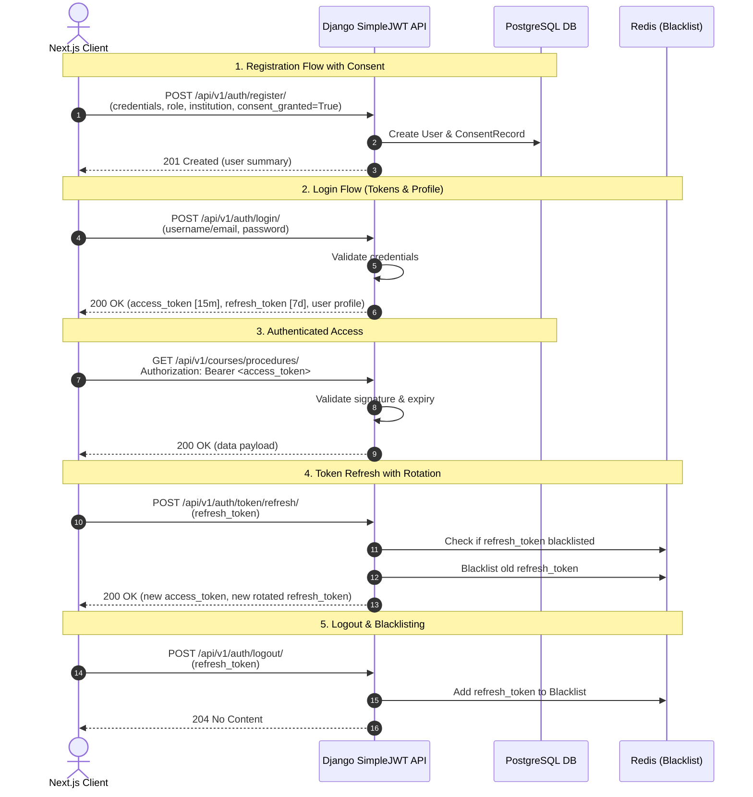

# REST API Specification

**Project Name:** AI Vocational Skills Trainer  
**Document Version:** 1.0 (Phase 2 Technical Architecture)  
**Status:** Approved for Implementation (Design Only)  
**Base URL:** `http://127.0.0.1:8000/api/v1/`  
**API Documentation Engine:** OpenAPI 3.0 via `drf-spectacular` (`/api/v1/schema/`, `/api/v1/docs/`)  
**Source of Truth:** `README.md`, `docs/phase1/*`, `docs/PRD.md`, `docs/DESIGN.md`, `docs/ARCHITECTURE.md`, `docs/DATABASE.md`

---

## 1. Architectural Conventions & Global Standards

### 1.1 Versioning & Path Structure
- The API is strictly versioned through the URL path prefix: `/api/v1/`.
- Future breaking changes will introduce `/api/v2/` while maintaining `/api/v1/` throughout a documented deprecation grace period.

### 1.2 Content Types & Headers
- Default Request / Response Format: `Content-Type: application/json`
- Video File Uploads: `Content-Type: multipart/form-data`
- Authentication Header: `Authorization: Bearer <access_token>`

### 1.3 Standardized Response Envelopes
All single-object responses return the resource dictionary at root or under a designated data key. List endpoints return a standardized pagination envelope.

#### Standard List / Pagination Envelope
The API uses DRF standard page-number pagination (`PageNumberPagination`):
```json
{
  "count": 142,
  "next": "http://127.0.0.1:8000/api/v1/practice/submissions/?page=2",
  "previous": null,
  "page": 1,
  "page_size": 20,
  "total_pages": 8,
  "results": []
}
```

### 1.4 Standardized Error Format
All errors return a consistent error object following RFC 7807 principles:

```json
{
  "error": {
    "code": "VALIDATION_ERROR",
    "message": "Invalid submission payload.",
    "details": {
      "video_file": [
        "The submitted file exceeds the maximum permitted size of 250MB."
      ]
    },
    "timestamp": "2026-11-21T21:15:00Z"
  }
}
```

#### Standard HTTP Status Codes:
- `200 OK`: Request succeeded.
- `201 Created`: Resource created successfully.
- `202 Accepted`: Request accepted for asynchronous processing (e.g., video queuing).
- `204 No Content`: Successful action with no response body.
- `400 Bad Request`: Validation failure or malformed payload.
- `401 Unauthorized`: Missing, expired, or invalid JWT token.
- `403 Forbidden`: Authenticated user lacks permission for the resource.
- `404 Not Found`: Target resource does not exist.
- `409 Conflict`: Resource state conflict (e.g., duplicate submission, already reviewed).
- `413 Payload Too Large`: Uploaded file exceeds 250MB.
- `422 Unprocessable Entity`: Semantic logic violation (e.g., consent not granted).
- `500 Internal Server Error`: Unhandled server exception.

---

## 2. Authentication & Authorization Lifecycle



---

## 3. Comprehensive Endpoint Specifications

### 3.1 Authentication & Profiles (`/api/v1/auth/`)

#### 3.1.1 Register User (`POST /api/v1/auth/register/`)
- **Permission:** `AllowAny`
- **Purpose:** Trainee enrollment, institutional linking, and legal consent registration.
- **Request Body:**
```json
{
  "username": "devraj_sharma",
  "email": "devraj.sharma@iti.edu",
  "password": "SecurePassword123!",
  "first_name": "Devraj",
  "last_name": "Sharma",
  "role": "LEARNER",
  "trainee_id_number": "TRN-2026-045",
  "institution_code": "GITI-MUMBAI",
  "consent": {
    "consent_version": "v1.0-2026",
    "is_granted": true
  }
}
```
- **Response `201 Created`:**
```json
{
  "id": "c7a8b9e0-1234-4567-89ab-cdef01234567",
  "username": "devraj_sharma",
  "email": "devraj.sharma@iti.edu",
  "role": "LEARNER",
  "first_name": "Devraj",
  "last_name": "Sharma",
  "trainee_id_number": "TRN-2026-045",
  "institution": {
    "id": "e4b5c6d7-8901-2345-6789-abcdef012345",
    "name": "Government ITI Mumbai",
    "code": "GITI-MUMBAI"
  },
  "consent_granted": true,
  "date_joined": "2026-11-21T21:15:30Z"
}
```

---

#### 3.1.2 Login (`POST /api/v1/auth/login/`)
- **Permission:** `AllowAny`
- **Purpose:** Issue short-lived access token and refresh token.
- **Request Body:**
```json
{
  "username": "devraj_sharma",
  "password": "SecurePassword123!"
}
```
- **Response `200 OK`:**
```json
{
  "access": "eyJhbGciOiJIUzI1NiIsInR5cCI6IkpXVCJ9.eyJ0b2tlbl90eXBlIjoiYWNjZXNzIiwiZXhwIjoxNzk1MzgwOTAwLCJqdGkiOiIxMjM0NTYiLCJ1c2VyX2lkIjoiYzdhOGI5ZTAtMTIzNC00NTY3LTg5YWItY2RlZjAxMjM0NTY3Iiwicm9sZSI6IkxFQVJORVIifQ...",
  "refresh": "eyJhbGciOiJIUzI1NiIsInR5cCI6IkpXVCJ9.eyJ0b2tlbl90eXBlIjoicmVmcmVzaCIsImV4cCI6MTc5NTk4NTcwMCwianRpIjoiNzg5MDEyIiwidXNlcl9pZCI6ImM3YThiOWUwLTEyMzQtNDU2Ny04OWFiLWNkZWYwMTIzNDU2NyJ9...",
  "user": {
    "id": "c7a8b9e0-1234-4567-89ab-cdef01234567",
    "username": "devraj_sharma",
    "email": "devraj.sharma@iti.edu",
    "role": "LEARNER",
    "first_name": "Devraj",
    "last_name": "Sharma",
    "trainee_id_number": "TRN-2026-045",
    "institution_name": "Government ITI Mumbai"
  }
}
```

---

#### 3.1.3 Token Refresh (`POST /api/v1/auth/token/refresh/`)
- **Permission:** `AllowAny`
- **Purpose:** Issue a new access token and rotate the refresh token.
- **Request Body:**
```json
{
  "refresh": "eyJhbGciOiJIUzI1NiIsInR5cCI6IkpXVCJ9..."
}
```
- **Response `200 OK`:**
```json
{
  "access": "eyJhbGciOiJIUzI1NiIsInR5cCI6IkpXVCJ9.new_access_token...",
  "refresh": "eyJhbGciOiJIUzI1NiIsInR5cCI6IkpXVCJ9.new_rotated_refresh_token..."
}
```

---

#### 3.1.4 Logout (`POST /api/v1/auth/logout/`)
- **Permission:** `IsAuthenticated`
- **Purpose:** Blacklist the current refresh token in Redis.
- **Request Body:**
```json
{
  "refresh": "eyJhbGciOiJIUzI1NiIsInR5cCI6IkpXVCJ9..."
}
```
- **Response `204 No Content`**

---

### 3.2 Consent Management (`/api/v1/consent/`)

#### 3.2.1 Get Consent Status (`GET /api/v1/consent/status/`)
- **Permission:** `IsAuthenticated`
- **Response `200 OK`:**
```json
{
  "consent_version": "v1.0-2026",
  "is_granted": true,
  "granted_at": "2026-11-21T21:15:30Z",
  "revoked_at": null,
  "can_upload_videos": true
}
```

#### 3.2.2 Revoke Consent (`POST /api/v1/consent/revoke/`)
- **Permission:** `IsLearner`
- **Request Body:**
```json
{
  "reason": "Requesting traditional in-person workshop observation."
}
```
- **Response `200 OK`:**
```json
{
  "status": "REVOKED",
  "message": "Consent has been withdrawn. Practice video upload permissions are disabled. Please notify your workshop instructor.",
  "revoked_at": "2026-11-21T21:20:00Z"
}
```

---

### 3.3 Curriculum & Procedures (`/api/v1/courses/`)

#### 3.3.1 List Procedures (`GET /api/v1/courses/procedures/`)
- **Permission:** `IsAuthenticated`
- **Query Parameters:** `difficulty` (optional), `module_id` (optional), `search` (optional)
- **Response `200 OK`:**
```json
{
  "count": 4,
  "results": [
    {
      "id": "b1c2d3e4-0001-4000-8000-000000000001",
      "procedure_code": "PROC-ELEC-01",
      "title": "Single-Pole One-Way Switch Controlling a Batten Lamp",
      "difficulty": "BEGINNER",
      "estimated_duration_minutes": 20,
      "total_steps": 10,
      "safety_critical_steps_count": 5
    },
    {
      "id": "b1c2d3e4-0002-4000-8000-000000000002",
      "procedure_code": "PROC-ELEC-02",
      "title": "Switch-Controlled 3-Pin Socket Outlet Installation",
      "difficulty": "INTERMEDIATE",
      "estimated_duration_minutes": 25,
      "total_steps": 9,
      "safety_critical_steps_count": 6
    }
  ]
}
```

---

#### 3.3.2 Get Procedure Detail (`GET /api/v1/courses/procedures/{procedure_code}/`)
- **Permission:** `IsAuthenticated`
- **Response `200 OK`:**
```json
{
  "id": "b1c2d3e4-0002-4000-8000-000000000002",
  "procedure_code": "PROC-ELEC-02",
  "title": "Switch-Controlled 3-Pin Socket Outlet Installation",
  "difficulty": "INTERMEDIATE",
  "estimated_duration_minutes": 25,
  "safety_instructions": "Power supply must remain disconnected and proven dead with multimeter before starting work.",
  "required_tools": [
    "Insulated combination pliers (1000V rated)",
    "Precision wire stripper",
    "Insulated screwdrivers",
    "Digital multimeter"
  ],
  "steps": [
    {
      "id": "f1a2b3c4-0001-4000-8000-000000000001",
      "step_number": 1,
      "step_code": "SKT-01",
      "title": "Verify Complete Supply Isolation (Dead Check)",
      "description": "Confirm power cord is visibly unplugged. Probe incoming terminals with AC voltmeter to confirm 0.0V.",
      "expected_tool": "Digital Multimeter",
      "visual_evidence_cue": "Disconnected cord plug visible; probes across leads showing 0.0V.",
      "is_safety_critical": true,
      "common_mistakes": "Relying on switch position alone; failing to verify multimeter functionality.",
      "hold_duration_seconds": 2
    },
    {
      "id": "f1a2b3c4-0002-4000-8000-000000000002",
      "step_number": 2,
      "step_code": "SKT-02",
      "title": "Inspect Components and Shutter Mechanism",
      "description": "Inspect switch and socket body for physical damage and verify shutter mechanism.",
      "expected_tool": "Visual Inspection",
      "visual_evidence_cue": "Trainee depresses earth aperture showing shutters open smoothly.",
      "is_safety_critical": false,
      "common_mistakes": "Installing socket with broken or jammed safety shutters.",
      "hold_duration_seconds": 2
    }
  ]
}
```

---

#### 3.3.3 Deactivate Procedure Step (`DELETE /api/v1/courses/steps/{id}/`)
- **Permission:** `IsCourseContentManagerOrReadOnly` (Trainer or Institution Admin)
- **Behavior:** Soft-deactivates the step (`is_active = false`) and returns `204 No Content`.
  - Inactive steps are automatically filtered out from `GET /api/v1/courses/steps/` list and detail responses, as well as from the nested `steps` array of `GET /api/v1/courses/procedures/{procedure_code}/`.
  - Inactive steps remain stored in the database, preserving all child `StepScore` linkages and audit history without data loss.
  - Re-using step numbers: Because step ordering is enforced via a partial unique index (`is_active = true`), deactivating a step frees its `step_number` for active re-use within the same procedure.
- **Response `204 No Content`**

---

### 3.4 Practice & Video Submissions (`/api/v1/practice/`)

#### 3.4.1 Create Practice Video Submission (`POST /api/v1/practice/submissions/`)
- **Permission:** `IsLearner`
- **Request Format:** `multipart/form-data`
- **Payload:**
  - `procedure_code`: `"PROC-ELEC-02"`
  - `video_file`: `<binary MP4/WebM file (max 250MB)>`
- **Response `201 Created`:**
```json
{
  "id": "9a8b7c6d-5432-4100-8200-112233445566",
  "procedure_code": "PROC-ELEC-02",
  "procedure_title": "Switch-Controlled 3-Pin Socket Outlet Installation",
  "processing_status": "QUEUED",
  "overall_ai_verdict": "PENDING",
  "submitted_at": "2026-11-21T21:22:00Z",
  "estimated_processing_seconds": 180,
  "status_check_url": "/api/v1/practice/submissions/9a8b7c6d-5432-4100-8200-112233445566/status/"
}
```

---

#### 3.4.2 Submission Status Polling (`GET /api/v1/practice/submissions/{id}/status/`)
- **Permission:** `IsOwnerOrTrainer`
- **Response `200 OK` (While In-Flight):**
```json
{
  "id": "9a8b7c6d-5432-4100-8200-112233445566",
  "processing_status": "PROCESSING",
  "progress_percentage": 65,
  "current_stage": "STAGE_3_SCORING_ENGINE",
  "overall_ai_verdict": "PENDING"
}
```

- **Response `200 OK` (Processing Completed):**
```json
{
  "id": "9a8b7c6d-5432-4100-8200-112233445566",
  "processing_status": "ANALYZED",
  "progress_percentage": 100,
  "overall_ai_verdict": "SAFETY_VIOLATION",
  "feedback_url": "/api/v1/practice/submissions/9a8b7c6d-5432-4100-8200-112233445566/scores/"
}
```

---

### 3.5 Assessment & Step Feedback (`/api/v1/practice/submissions/{id}/scores/`)

#### 3.5.1 Get Step Feedback Report (`GET /api/v1/practice/submissions/{id}/scores/`)
- **Permission:** `IsOwnerOrTrainer`
- **Purpose:** Full evaluation report powering Screen 7 (Learner Feedback) and Screen 9 (Trainer Review).
- **Response `200 OK`:**
```json
{
  "submission_id": "9a8b7c6d-5432-4100-8200-112233445566",
  "procedure_code": "PROC-ELEC-02",
  "video_url": "https://storage.vtrainer.local/videos/2026/11/21/socket_practice_devraj.mp4?token=signed_exp_1795384500",
  "video_duration_seconds": 382.4,
  "overall_ai_verdict": "SAFETY_VIOLATION",
  "verdict_summary": "Safety Violation Detected. Excessive bare copper conductor exposed on protective earth terminal.",
  "trainer_review": null,
  "steps": [
    {
      "step_number": 1,
      "step_code": "SKT-01",
      "title": "Verify Complete Supply Isolation (Dead Check)",
      "is_safety_critical": true,
      "ai_status": "CORRECT",
      "confidence_score": 0.94,
      "timestamp_start": 12.0,
      "timestamp_end": 35.5,
      "ai_feedback": "Supply cord plug clearly placed in frame. Multimeter verified 0.0V AC across all incoming terminals.",
      "errors": []
    },
    {
      "step_number": 3,
      "step_code": "SKT-03",
      "title": "Prepare & Terminate Protective Earth Conductor",
      "is_safety_critical": true,
      "ai_status": "INCORRECT",
      "confidence_score": 0.91,
      "timestamp_start": 58.0,
      "timestamp_end": 94.2,
      "ai_feedback": "Conductor stripped excessively (~18mm). 6mm of bare copper exposed outside earth collar, creating shock and flashover risk.",
      "errors": [
        {
          "error_tag_code": "EXCESS_COPPER_EXPOSED",
          "name": "Excess Copper Exposed",
          "severity": "Safety-Critical",
          "snapshot_url": "https://storage.vtrainer.local/snapshots/err_skt03_0245.jpg",
          "bounding_box": {
            "ymin": 0.42,
            "xmin": 0.51,
            "ymax": 0.58,
            "xmax": 0.65
          }
        }
      ]
    }
  ]
}
```

---

### 3.6 Trainer Review & Triage Queue (`/api/v1/trainer/`)

#### 3.6.1 Get Prioritized Review Queue (`GET /api/v1/trainer/queue/`)
- **Permission:** `IsTrainer`
- **Query Parameters:** `status` (default: `ANALYZED`), `filter` (`safety_only`, `passed_only`, `all`)
- **Response `200 OK`:**
```json
{
  "total_pending": 8,
  "safety_alerts_count": 3,
  "results": [
    {
      "submission_id": "9a8b7c6d-5432-4100-8200-112233445566",
      "learner_name": "Devraj Sharma",
      "trainee_id_number": "TRN-2026-045",
      "procedure_code": "PROC-ELEC-02",
      "procedure_title": "Switch-Controlled Socket Outlet",
      "submitted_at": "2026-11-21T21:05:00Z",
      "overall_ai_verdict": "SAFETY_VIOLATION",
      "flagged_error_summary": "EXCESS_COPPER_EXPOSED (Step 3)",
      "priority_tier": "HIGH_SAFETY_ALERT"
    },
    {
      "submission_id": "1a2b3c4d-5678-4900-8100-998877665544",
      "learner_name": "Pooja Patel",
      "trainee_id_number": "TRN-2026-022",
      "procedure_code": "PROC-ELEC-01",
      "procedure_title": "Single-Pole Switch & Lamp",
      "submitted_at": "2026-11-21T20:15:00Z",
      "overall_ai_verdict": "PASS",
      "flagged_error_summary": "All 10 steps correct",
      "priority_tier": "STANDARD_APPROVAL"
    }
  ]
}
```

---

#### 3.6.2 Submit Official Trainer Review (`POST /api/v1/trainer/reviews/`)
- **Permission:** `IsTrainer`
- **Purpose:** Records instructor adjudication, grade sign-off, and score overrides.
- **Request Body:**
```json
{
  "submission_id": "9a8b7c6d-5432-4100-8200-112233445566",
  "final_grade": "SAFETY_FAIL",
  "trainer_comments": "Conductor stripping length is too long. Please trim 5mm off the copper before inserting into the earth terminal.",
  "is_overridden": false,
  "step_overrides": {}
}
```
- **Response `201 Created`:**
```json
{
  "review_id": "8c7b6a5d-4321-4111-9222-334455667788",
  "submission_id": "9a8b7c6d-5432-4100-8200-112233445566",
  "trainer_name": "R. K. Verma",
  "final_grade": "SAFETY_FAIL",
  "reviewed_at": "2026-11-21T21:26:00Z",
  "submission_status": "REVIEWED"
}
```

---

### 3.7 Institutional Analytics & Accreditation (`/api/v1/analytics/`)

#### 3.7.1 Cohort Executive Metrics (`GET /api/v1/analytics/cohort-summary/`)
- **Permission:** `IsInstitutionAdmin`
- **Response `200 OK`:**
```json
{
  "institution_code": "GITI-MUMBAI",
  "academic_term": "Academic Year 2026 - Term 1",
  "enrolled_trainees": 142,
  "active_batches": 6,
  "total_submissions_logged": 586,
  "first_time_safety_compliance_rate": 88.4,
  "average_trainer_review_minutes": 1.8
}
```

#### 3.7.2 Error Frequency Aggregation (`GET /api/v1/analytics/error-frequencies/`)
- **Permission:** `IsInstitutionAdmin`
- **Response `200 OK`:**
```json
{
  "trade_code": "ELEC",
  "total_errors_detected": 134,
  "top_failure_modes": [
    {
      "error_tag_code": "EXCESS_COPPER_EXPOSED",
      "category": "Workmanship",
      "severity": "Safety-Critical",
      "count": 48,
      "percentage": 35.8
    },
    {
      "error_tag_code": "LOOSE_TERMINATION",
      "category": "Mechanical",
      "severity": "Procedural",
      "count": 31,
      "percentage": 23.1
    },
    {
      "error_tag_code": "REVERSE_POLARITY",
      "category": "Safety",
      "severity": "Safety-Critical",
      "count": 14,
      "percentage": 10.4
    }
  ]
}
```

---

### 3.8 Contextual AI RAG Tutor Guidance (`/api/v1/tutor/guidance/`)

#### 3.8.1 Ask Procedural Guidance (`POST /api/v1/tutor/guidance/`)
- **Permission:** `IsLearner`
- **Purpose:** Context-aware pedagogical guidance grounded in verified electrical practical manuals.
- **Request Body:**
```json
{
  "procedure_code": "PROC-ELEC-02",
  "step_code": "SKT-03",
  "query": "How many millimeters of bare copper should I expose when inserting the wire into the 16A socket earth terminal?"
}
```
- **Response `200 OK`:**
```json
{
  "answer": "According to standard domestic wiring guidelines, strip approximately 10mm to 12mm of insulation. When inserted into the terminal collar, no more than 2mm of bare copper should remain exposed outside the insulating shroud, and the terminal screw must clamp down firmly onto the copper core without pinching the plastic insulation.",
  "grounded_sources": [
    {
      "document": "Standard Vocational Electrician Practical Handbook",
      "section": "Section 4.2: Terminal Connections and Cable Preparation",
      "verified_safe": true
    }
  ]
}
```
