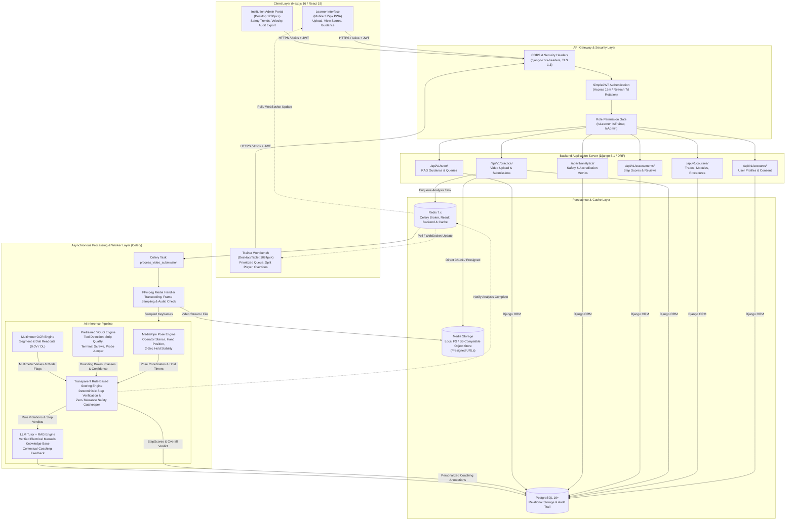
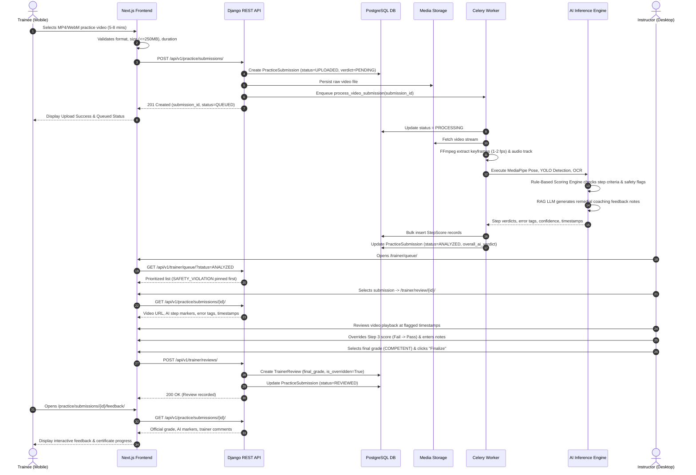

# System Architecture Specification

**Project Name:** Hunar  
**Document Version:** 1.0 (Phase 2 Technical Design)  
**Status:** Approved for Implementation Architecture  
**Backend:** Django 6.1 + Django REST Framework + PostgreSQL 16+ + SimpleJWT + Celery 5.4 + Redis 7  
**Frontend:** Next.js 16 (App Router) + React 19 + TypeScript + Tailwind CSS 4 + Axios  
**AI Inference Pipeline:** MediaPipe Pose + Pretrained YOLOv8/v11 + Rule-Based Scoring Engine + LLM Tutor with RAG  
**Primary MVP Trade:** Basic Electrical Wiring (`PROC-ELEC-01` to `04`)  
**Source of Truth:** `README.md`, `docs/phase1/*`, `docs/PRD.md`, `docs/DESIGN.md`

---

## 1. System Overview

**Hunar** is an asynchronous, video-assisted skills evaluation and instructional platform designed for technical vocational training institutions (e.g., Industrial Training Institutes [ITIs] and polytechnics). The architecture decouples high-bandwidth, variable-duration video capture on budget client devices from computationally intensive multi-stage computer vision inference and human instructor moderation.

### Architectural Principles:
1. **Asynchronous Non-Blocking Processing:** Video uploads and AI inference run out-of-band via Celery background task workers backed by Redis, keeping the DRF HTTP API responsive.
2. **Deterministic Safety-First Gatekeeping:** Machine learning inferences feed into a transparent, rule-based scoring engine. Safety-critical violations trigger deterministic penalties, eliminating model hallucinations on life-critical steps.
3. **Human-in-the-Loop (HITL) Authority:** The AI serves as an automated triage and pre-scoring assistant. Human instructors maintain unilateral authority to confirm, modify, or override any step score before final institutional certification.
4. **Data Isolation and Student Privacy:** Strict role-based access control (RBAC), short-lived signed media URLs, and encrypted storage isolate student likenesses and performance records.

---

## 2. High-Level Architecture Diagram



---

## 3. Core System Components

### 3.1 Frontend Client (Next.js 16 / React 19)
- **Framework & Runtime:** Next.js 16 with App Router, React 19, TypeScript 5+, Tailwind CSS 4.
- **Client Networking:** Axios client configured with automatic request/response interceptors in `frontend/lib/api.ts` to manage JWT Bearer attachment, proactive access token refresh, and network failure retries.
- **Media Playback Engine:** HTML5 `<video>` element wrapped with a custom React controller supporting bi-directional time-scrubbing, timestamp jump buttons, colored timeline markers, and playback rate acceleration (1.0x, 1.25x, 1.5x, 2.0x).
- **Responsive Layout:** Mobile-first layout targeting standard Android viewports ($375\text{px}$) for learners, scaling to multi-column split-screen workspaces ($1024\text{px}+$) for instructors.

### 3.2 Application Server & API (Django 6.1 / DRF)
- **Framework:** Python 3.12, Django 6.1, Django REST Framework (DRF) 3.15+.
- **Authentication:** `djangorestframework-simplejwt` with asymmetric or HMAC-SHA256 token signing, sliding expiration, and token blacklisting on logout.
- **API Documentation:** `drf-spectacular` generating OpenAPI 3.0 schemas and Swagger UI.
- **CORS & Security:** `django-cors-headers` restricting origins to authorized frontend domains, strict Content Security Policy (CSP), and HTTP security headers.

### 3.3 Relational Database (PostgreSQL 16+)
- **Role:** Primary persistent data store for user credentials, institutional hierarchy, curricular procedures, step rubrics, submissions, step scores, instructor reviews, and immutable consent audit records.
- **Integrity & Concurrency:** ACID transactions with strict foreign key constraints, composite indexing on query paths, and soft-delete tombstoning.

### 3.4 Worker Queue & In-Memory Broker (Celery & Redis)
- **Broker & Backend:** Redis 7.x serving as Celery task message broker and result backend.
- **Task Concurrency:** Celery 5.4 worker instances configured with worker pools separated by workload:
  - `cpu_worker`: Handles video transcoding, frame sampling, and OCR processing.
  - `ai_worker`: Handles MediaPipe pose estimation, YOLO bounding-box inference, and rule evaluation.
  - `io_worker`: Handles notifications, audit log generation, and file cleanup tasks.

### 3.5 Media & Video Storage
- **Local Development:** Django local media storage served via secure, authenticated proxy views.
- **Cloud Production:** S3-compatible private object storage (AWS S3, Cloudflare R2, or MinIO) with time-limited presigned URLs (15–30 minute expiration). No direct public access to student media.

### 3.6 AI Inference Services & Pipelines

The AI pipeline is modular, combining lightweight pretrained computer vision models with a deterministic scoring engine and an LLM tutor:

```
┌────────────────────────────────────────────────────────────────────────┐
│                        AI INFERENCE PIPELINE                           │
├──────────────────────┬──────────────────────┬──────────────────────────┤
│ Stage                │ Model / Engine       │ Operational Role         │
├──────────────────────┼──────────────────────┼──────────────────────────┤
│ 1. Pose & Stability  │ MediaPipe Pose       │ Evaluates operator hands,│
│                      │                      │ stance, body position,   │
│                      │                      │ and 2-sec inspection     │
│                      │                      │ hold stability.          │
├──────────────────────┼──────────────────────┼──────────────────────────┤
│ 2. Tool & Object     │ Pretrained YOLO      │ Detects wire strippers,  │
│    Detection         │ (YOLOv8/v11)         │ 1000V pliers, terminal   │
│                      │                      │ screws, copper exposure, │
│                      │                      │ and lead probe positions.│
├──────────────────────┼──────────────────────┼──────────────────────────┤
│ 3. Instrument OCR    │ Pretrained Optical   │ Reads 7-segment and text │
│                      │ Character Recognition│ displays on multimeters  │
│                      │ (e.g. PaddleOCR/Tess)│ (0.0V, OL, <0.5 ohm).    │
├──────────────────────┼──────────────────────┼──────────────────────────┤
│ 4. Scoring Engine    │ Transparent Rule     │ Executes deterministic   │
│                      │ Engine (Python)      │ validation rubrics; locks│
│                      │                      │ safety-critical steps.   │
├──────────────────────┼──────────────────────┼──────────────────────────┤
│ 5. Contextual Tutor  │ LLM + RAG            │ Generates grounded,      │
│                      │ (Vector DB + Manuals)│ pedagogical feedback     │
│                      │                      │ without hallucinations.  │
└──────────────────────┴──────────────────────┴──────────────────────────┘
```

#### Detailed AI Component Responsibilities:
1. **MediaPipe Pose Engine:**
   - Detects trainee wrist, elbow, and shoulder landmarks.
   - Verifies trainee presence, framing distance (50–70cm from board), and detects whether forearms obstruct the workpiece.
   - Enforces the **"2-Second Inspection Hold"** (`filming-guidelines.md`): measures optical variance of stripped wire ends and tightened terminals to verify the trainee held the component static for camera autofocus.
2. **Pretrained YOLO Object Detection Engine:**
   - Detects tools (insulated pliers, wire stripper, multimeter, screwdrivers).
   - Localizes electrical components (switch box, 3-pin socket, lamp holder, disconnected supply plug).
   - Detects critical failure artifacts: excessive exposed copper ($> 2\text{mm}$ outside terminal collar), strand nicking/severing, and wrong wire insertion ports.
3. **Multimeter OCR Engine:**
   - Detects multimeter dial position (AC Voltage, DC Voltage, Resistance/Continuity, 10A current jack).
   - Extracts numerical LCD values to confirm zero-energy verification ($0.0\text{V AC}$), protective earth continuity ($< 0.5\Omega$), and open-circuit isolation ($\text{OL}$ / infinite resistance).
4. **Transparent Rule-Based Scoring Engine:**
   - Combines spatial, temporal, and classification outputs from Stages 1–3 against the procedure rubric.
   - Evaluates each step as `CORRECT`, `INCORRECT`, or `INCONCLUSIVE`.
   - **Deterministic Safety Gatekeeper:** If a step marked `is_safety_critical=True` fails or has an error tag assigned (e.g., `OMITTED_ISOLATION`, `EXCESS_COPPER_EXPOSED`, `REVERSE_POLARITY`, `METER_JACK_ERROR`), the overall attempt is immediately stamped as `SAFETY_VIOLATION`.
   - Visual ambiguity or model confidence $< 0.70$ on safety-critical steps automatically defaults to `INCONCLUSIVE` and escalates to the trainer.
5. **LLM Tutor with RAG over Verified Manuals:**
   - Consumes detected step errors, timestamps, and procedure context.
   - Retrieves authoritative guidance excerpts from a verified vector database of standard vocational electrical manuals (e.g., standard trade practical handbooks).
   - Generates constructive, encouraging, plain-language remedial feedback for the trainee (e.g., *"Step 3 failed because 6mm of bare copper is exposed. Next time, trim conductor to 10mm before inserting into the earth collar."*).
   - Operates strictly with temperature = 0.0 to prevent hallucination of electrical standards or safety advice.

---

## 4. End-to-End Video Lifecycle: From Upload to Score to Review

The diagram below details the sequence of operations from initial trainee video capture to finalized instructor grading:



---

## 5. Repository & Application Folder Structure

The repository maintains strict separation of backend, frontend, documentation, and dataset assets:

```
vocational-trainer/
├── .gitignore
├── README.md
├── docs/
│   ├── ARCHITECTURE.md                  # This technical system architecture design
│   ├── DATABASE.md                      # Complete database schema, indexes, ERD & migrations
│   ├── API.md                           # REST API plan, endpoints, error formats & auth flows
│   ├── PRD.md                           # Product Requirements Document
│   ├── DESIGN.md                        # UI/UX design system & Stitch AI frontend specs
│   └── phase1/                          # Phase 1 foundation documents (Source of Truth)
│       ├── README.md                    # Phase 1 index & deliverable checklist
│       ├── scope.md                     # Boundaries, trade scope & quantitative success metrics
│       ├── data-model.md                # Initial Django data model specifications (Design only)
│       ├── data-plan.md                 # Video dataset acquisition, splits & benchmarking plan
│       ├── filming-guidelines.md        # Trainee recording framing & 5-point checklist
│       ├── consent-and-privacy.md       # Student video recording privacy policy & consent form
│       ├── screens.md                   # 11 screen specs with ready-to-paste Stitch AI prompts
│       └── procedures/                  # 4 standardized electrical wiring procedures
│           ├── 01-single-pole-switch-and-lamp.md
│           ├── 02-switch-controlled-socket-outlet.md
│           ├── 03-staircase-wiring-two-way-control.md
│           └── 04-dead-circuit-testing-and-verification.md
├── backend/
│   ├── .env                             # Local environment secrets (gitignored)
│   ├── .env.example                     # Environment template
│   ├── manage.py
│   ├── requirements.txt                 # Python dependencies
│   ├── config/                          # Django project core
│   │   ├── __init__.py
│   │   ├── asgi.py
│   │   ├── wsgi.py
│   │   ├── urls.py                      # Global URL router (/api/v1/ routes)
│   │   └── settings.py                  # Core Django configuration
│   ├── accounts/                        # User management, RBAC, JWT, ConsentRecords
│   ├── courses/                         # Trades, Modules, Procedures, ProcedureSteps
│   ├── practice/                        # PracticeSubmissions, Video upload handlers
│   ├── assessments/                     # StepScores, TrainerReviews, Rubrics, Overrides
│   ├── analytics/                       # Cohort metrics, Safety failure frequencies
│   └── ai_pipeline/                     # (Phase 3/4) Celery tasks, MediaPipe, YOLO, RAG
│       ├── tasks.py                     # Celery task entry points
│       ├── extractors/                  # FFmpeg frame sampling & audio utilities
│       ├── vision/                      # MediaPipe pose & YOLO object inference wrappers
│       ├── ocr/                         # Multimeter display segment OCR
│       ├── engine/                      # Deterministic rule-based scoring engine
│       └── rag/                         # Vector embeddings & verified manual retriever
├── frontend/
│   ├── .env.local                       # Next.js local environment variables (gitignored)
│   ├── .env.example                     # Template
│   ├── package.json
│   ├── tsconfig.json
│   ├── next.config.ts
│   ├── app/                             # Next.js 16 App Router
│   │   ├── layout.tsx                   # Global root layout (Inter font, providers)
│   │   ├── page.tsx                     # Landing / entry redirect
│   │   ├── (auth)/                      # Authentication route group (Login, Register)
│   │   ├── (learner)/                   # Trainee routes (Dashboard, Catalog, Upload, Feedback)
│   │   ├── (trainer)/                   # Trainer routes (Triage Queue, Review Detail)
│   │   └── (admin)/                     # Institutional admin routes (Analytics, Audit)
│   ├── components/                      # Modular React 19 components
│   │   ├── ui/                          # Reusable UI atoms (Button, Badge, Card, Modal)
│   │   ├── video/                       # VideoPlayer, TimelineScrubber, MarkerPin
│   │   └── rubrics/                     # StepRubricCard, OverrideSelector, ErrorTagBadge
│   ├── lib/                             # Core frontend libraries & utilities
│   │   ├── api.ts                       # Axios client instance with JWT interceptors
│   │   └── auth.ts                      # Session & token storage utilities
│   ├── types/                           # TypeScript interfaces matching backend models
│   └── public/                          # Static media, icons, logo assets
└── dataset/                             # (Phase 1/2 Data Plan) Pilot video benchmark assets
    ├── README.md
    ├── metadata.json
    ├── raw_videos/                      # Structured by procedure code (gitignored)
    └── annotations/                     # Ground truth JSON annotations from trainers
```

---

## 6. Environment Architecture: Local Development vs. Cloud Production

### 6.1 Local Development Environment (Current Phase)
The local development setup operates entirely on Windows using Antigravity's integrated PowerShell terminal:
- **Operating System:** Windows 11 / Windows Server (Local Developer Machine).
- **Backend Runtime:** Python 3.12 virtual environment (`backend/venv`).
- **Database:** Local PostgreSQL 16+ running on port `5432` (`vtrainer` database).
- **In-Memory Cache / Broker:** Redis 7.x running locally (via native Windows service, Redis for Windows, or WSL2) on port `6379`.
- **Worker Execution:** Celery running with `-P solo` or `--pool=threads` for Windows compatibility:
  ```powershell
  celery -A config worker --loglevel=info -P solo
  ```
- **Media Storage:** Local filesystem storage under `backend/media/submissions/videos/%Y/%m/%d/`.
- **Frontend Runtime:** Node.js 20+ with Next.js development server (`http://localhost:3000`).
- **AI Execution:** Local CPU or DirectML/CUDA GPU execution for lightweight MediaPipe and YOLO inference on sample test clips.

### 6.2 Cloud Production Architecture (Future Deployment)
The production deployment scales horizontally to accommodate multiple vocational institutes:
- **Compute (Web & API):** Containerized Django application running in Docker containers orchestrated via Kubernetes (EKS/GKE) or AWS ECS behind an Application Load Balancer (ALB).
- **Compute (Inference Workers):** Dedicated GPU-enabled Celery worker nodes (e.g., NVIDIA T4 / A10G instances) for batch video processing, with autoscaling based on Redis queue depth.
- **Frontend Hosting:** Next.js deployed on Vercel Edge Network or AWS CloudFront + ECS with global CDN caching for static assets.
- **Managed Database:** AWS Aurora PostgreSQL / GCP Cloud SQL with Multi-AZ redundancy, automated backups, and read replicas for analytical queries.
- **Managed Cache:** AWS ElastiCache for Redis (Cluster Mode enabled) with automated failover.
- **Object Storage:** Private AWS S3 or Cloudflare R2 bucket with client-side direct uploads via presigned S3 URLs, lifecycle policies, and server-side encryption (SSE-S3 / SSE-KMS).
- **Observability:** Prometheus + Grafana for Celery queue depth and system metrics; Sentry for exception tracking; OpenTelemetry for distributed API tracing.

---

## 7. Security, Privacy, and Compliance Architecture

### 7.1 Role-Based Access Control (RBAC) Matrix
The platform enforces granular permissions via Django REST Framework permission classes:

| Resource / Endpoint | `LEARNER` | `TRAINER` | `INSTITUTION_ADMIN` | `SUPER_ADMIN` |
| :--- | :---: | :---: | :---: | :---: |
| View Course Procedures & Rubrics | Read-Only | Read-Only | Read-Only | Full Access |
| Submit Practice Video | Create (Own) | No Access | No Access | Full Access |
| View Submission Video & AI Feedback | Read (Own Only) | Read (Assigned Cohort) | Read (Institutional) | Full Access |
| Trainer Review Queue & Triage | No Access | Read / Filter | Read-Only Summary | Full Access |
| Step Score Override & Final Grade | No Access | Create / Update | No Access | Full Access |
| Institutional Safety & KPI Analytics | No Access | Cohort Aggregates | Full Institutional | Multi-Tenant |
| Export Accreditation Audit Logs | No Access | No Access | Export (Own Inst.) | Full Export |
| Trainee Consent Revocation | Revoke (Own) | No Access | Read Audit Proof | Full Access |

### 7.2 JWT Authentication Lifecycle & Security
1. **Token Composition:**
   - **Access Token:** Short-lived (15 minutes). Contains user UUID, role (`LEARNER`, `TRAINER`, etc.), and institutional affiliation. Signed with HMAC-SHA256 (`HS256`) or RSA private key (`RS256`).
   - **Refresh Token:** Long-lived (7 days). Stored in an encrypted, `HttpOnly`, `SameSite=Strict`, `Secure` cookie to mitigate Cross-Site Scripting (XSS) token theft.
2. **Token Rotation & Blacklisting:** Every token refresh cycle issues a new access token AND a new rotated refresh token. The previous refresh token is immediately blacklisted in Redis.
3. **Brute Force Protection:** Django Ratelimit enforces a limit of 5 failed login attempts per IP/username per 15-minute window.

### 7.3 Video Privacy & Media Isolation
Because practice videos depict student likenesses, workbenches, and institutional facilities, video data is protected through multi-layered controls:
1. **Zero Public Buckets:** Media storage buckets are 100% private. Direct bucket browsing and anonymous HTTP access are disabled at the cloud IAM policy level.
2. **Time-Limited Presigned Access:** Media URLs delivered to the frontend are dynamically generated presigned URLs with a maximum expiration of **30 minutes**. URLs expire quickly, preventing unauthorized sharing or persistent link harvesting.
3. **Institutional Boundary Check:** The API layer verifies that the requesting user's `institution_id` matches the submission's `institution_id` before generating a presigned URL.

### 7.4 Consent Management & Right to Erasure
In compliance with data protection principles and [consent-and-privacy.md](file:///c:/dev/vocational-trainer/docs/phase1/consent-and-privacy.md):
1. **Immutable Consent Ledger:** Every trainee must review the plain-language consent terms at registration. The system logs `user_id`, `consent_version`, `ip_address`, `user_agent`, and `granted_at` into `ConsentRecord`.
2. **Right to Withdraw:** Trainees can withdraw recording consent via the profile interface. Revoking consent immediately blocks future video upload endpoints and alerts the instructor to schedule traditional in-person workshop observations.
3. **Retention & Deletion Policy:** Raw videos are maintained for the active semester plus an additional **6-month accreditation audit window**, after which raw facial footage is purged or permanently de-identified.
