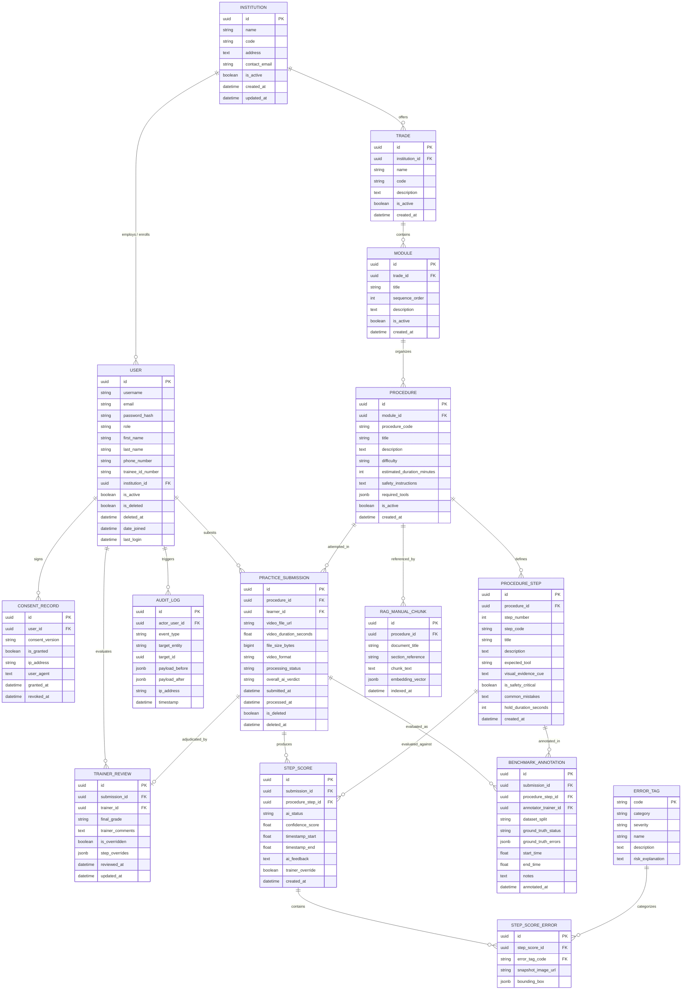

# Relational Database Schema Specification

**Project Name:** AI Vocational Skills Trainer  
**Document Version:** 1.0 (Phase 2 Technical Architecture)  
**Status:** Approved for Implementation (Design Specification Only — No Migrations in Phase 1)  
**Database Engine:** PostgreSQL 16+  
**ORM Framework:** Django 6.1 ORM (`psycopg2-binary`)  
**Source of Truth:** `README.md`, `docs/phase1/data-model.md`, `docs/phase1/data-plan.md`, `docs/phase1/consent-and-privacy.md`, `docs/PRD.md`

---

## 1. Architectural Overview & Database Principles

The database architecture is designed for institutional multi-tenancy, strict role-based access control (RBAC), auditable evaluation pipelines, and high-integrity AI assessment logging. 

### Core Schema Principles:
1. **UUID Primary Keys:** All core entity tables utilize Universally Unique Identifiers (UUIDv4) as primary keys to prevent enumeration attacks, simplify client-side ID handling, and enable future distributed multi-region replication.
2. **Deterministic Foreign Key Cascades:** Referential integrity rules are strictly modeled. Academic structures (`Trade`, `Module`, `Procedure`, `ProcedureStep`) use `PROTECT` on delete to prevent accidental orphan grading data. User deletions utilize soft-deletes or `SET_NULL` to preserve legal grading audit trails.
3. **Structured Taxonomy Over Plain Text:** Standardized error tags and procedural failure modes are normalized into a formal dictionary table (`error_tags`), enabling fast aggregation queries across student cohorts.
4. **Immutable Audit Trails:** Changes to official grades, human trainer score overrides, and student privacy consent states are logged with timestamps, IP addresses, and user IDs.
5. **Separation of Operational and Benchmarking Data:** Ground-truth annotations from certified instructors are stored with partition flags to support the 60/20/20 dataset splits specified in `data-plan.md`.

---

## 2. Mermaid Entity-Relationship (ER) Diagram



---

## 3. Comprehensive Table Specifications

### 3.1 `institutions`
Represents an accredited partner vocational training institute, ITI, or polytechnic.

| Field Name | PostgreSQL Type | Constraints & Modifiers | Description |
| :--- | :--- | :--- | :--- |
| `id` | `UUID` | `PRIMARY KEY`, Default: `gen_random_uuid()` | Unique institution identifier |
| `name` | `VARCHAR(255)` | `NOT NULL`, `UNIQUE` | Full legal institution name |
| `code` | `VARCHAR(50)` | `NOT NULL`, `UNIQUE` | Short institutional code (e.g., `GITI-MUMBAI`) |
| `address` | `TEXT` | `NULL` | Physical postal address of campus |
| `contact_email`| `VARCHAR(254)` | `NOT NULL` | Administrative contact email |
| `is_active` | `BOOLEAN` | `NOT NULL`, Default: `TRUE` | Whether institution is currently operational |
| `created_at` | `TIMESTAMPTZ` | `NOT NULL`, Default: `NOW()` | Timestamp of creation |
| `updated_at` | `TIMESTAMPTZ` | `NOT NULL`, Default: `NOW()` | Timestamp of last modification |

---

### 3.2 `users` (Custom User Model extending `AbstractUser`)
Stores all platform actors with role-based attributes and institutional links.

| Field Name | PostgreSQL Type | Constraints & Modifiers | Description |
| :--- | :--- | :--- | :--- |
| `id` | `UUID` | `PRIMARY KEY`, Default: `gen_random_uuid()` | Unique user identifier |
| `username` | `VARCHAR(150)` | `NOT NULL`, `UNIQUE` | System username |
| `email` | `VARCHAR(254)` | `NOT NULL`, `UNIQUE` | Institutional or personal email |
| `password` | `VARCHAR(128)` | `NOT NULL` | Django PBKDF2/Argon2 password hash |
| `role` | `VARCHAR(20)` | `NOT NULL`, Default: `'LEARNER'` | Check: `IN ('LEARNER', 'TRAINER', 'INSTITUTION_ADMIN', 'SUPER_ADMIN')` |
| `first_name` | `VARCHAR(150)` | `NOT NULL`, Default: `''` | Given name |
| `last_name` | `VARCHAR(150)` | `NOT NULL`, Default: `''` | Family name |
| `phone_number` | `VARCHAR(20)` | `NULL` | Contact phone for mobile notifications |
| `trainee_id_number`| `VARCHAR(100)` | `NULL` | Student roll / enrollment ID (e.g. `TRN-2026-045`) |
| `institution_id`| `UUID` | `NULL`, `FOREIGN KEY REFERENCES institutions(id) ON DELETE SET_NULL` | Affiliated training institute |
| `is_active` | `BOOLEAN` | `NOT NULL`, Default: `TRUE` | Account active status |
| `is_deleted` | `BOOLEAN` | `NOT NULL`, Default: `FALSE` | Soft delete flag |
| `deleted_at` | `TIMESTAMPTZ` | `NULL` | Timestamp when soft deleted |
| `date_joined` | `TIMESTAMPTZ` | `NOT NULL`, Default: `NOW()` | Account creation date |
| `last_login` | `TIMESTAMPTZ` | `NULL` | Timestamp of last authentication |

---

### 3.3 `consent_records`
Maintains an immutable legal audit trail of trainee video recording consent agreements.

| Field Name | PostgreSQL Type | Constraints & Modifiers | Description |
| :--- | :--- | :--- | :--- |
| `id` | `UUID` | `PRIMARY KEY`, Default: `gen_random_uuid()` | Unique consent record ID |
| `user_id` | `UUID` | `NOT NULL`, `FOREIGN KEY REFERENCES users(id) ON DELETE CASCADE` | Associated learner |
| `consent_version`| `VARCHAR(20)`| `NOT NULL` | Policy document version (e.g., `v1.0-2026`) |
| `is_granted` | `BOOLEAN` | `NOT NULL`, Default: `FALSE` | Explicit consent opt-in status |
| `ip_address` | `INET` | `NULL` | Trainee IP address at consent submission |
| `user_agent` | `TEXT` | `NULL` | Client browser user-agent string |
| `granted_at` | `TIMESTAMPTZ` | `NOT NULL`, Default: `NOW()` | Timestamp when consent was granted |
| `revoked_at` | `TIMESTAMPTZ` | `NULL` | Timestamp when consent was withdrawn (if any) |

---

### 3.4 `trades`
Top-level vocational craft categorization.

| Field Name | PostgreSQL Type | Constraints & Modifiers | Description |
| :--- | :--- | :--- | :--- |
| `id` | `UUID` | `PRIMARY KEY`, Default: `gen_random_uuid()` | Unique trade ID |
| `institution_id`| `UUID` | `NOT NULL`, `FOREIGN KEY REFERENCES institutions(id) ON DELETE CASCADE` | Offering institution |
| `name` | `VARCHAR(150)` | `NOT NULL` | Name of trade (e.g., `Electrician`) |
| `code` | `VARCHAR(20)` | `NOT NULL` | Trade code (e.g., `ELEC`) |
| `description` | `TEXT` | `NULL` | High-level curriculum overview |
| `is_active` | `BOOLEAN` | `NOT NULL`, Default: `TRUE` | Trade status |
| `created_at` | `TIMESTAMPTZ` | `NOT NULL`, Default: `NOW()` | Timestamp created |

---

### 3.5 `modules`
Curricular instructional units organized under a specific trade.

| Field Name | PostgreSQL Type | Constraints & Modifiers | Description |
| :--- | :--- | :--- | :--- |
| `id` | `UUID` | `PRIMARY KEY`, Default: `gen_random_uuid()` | Unique module ID |
| `trade_id` | `UUID` | `NOT NULL`, `FOREIGN KEY REFERENCES trades(id) ON DELETE CASCADE` | Parent trade |
| `title` | `VARCHAR(200)` | `NOT NULL` | Module title (e.g., `Domestic Wiring & Installation`) |
| `sequence_order`| `INT` | `NOT NULL`, Default: `1` | Ordering index in course syllabus |
| `description` | `TEXT` | `NULL` | Module objectives and syllabus scope |
| `is_active` | `BOOLEAN` | `NOT NULL`, Default: `TRUE` | Active flag |
| `created_at` | `TIMESTAMPTZ` | `NOT NULL`, Default: `NOW()` | Timestamp created |

---

### 3.6 `procedures`
Specific hands-on physical workbench wiring tasks evaluated by video.

| Field Name | PostgreSQL Type | Constraints & Modifiers | Description |
| :--- | :--- | :--- | :--- |
| `id` | `UUID` | `PRIMARY KEY`, Default: `gen_random_uuid()` | Unique procedure ID |
| `module_id` | `UUID` | `NOT NULL`, `FOREIGN KEY REFERENCES modules(id) ON DELETE PROTECT` | Parent curricular module |
| `procedure_code`| `VARCHAR(50)` | `NOT NULL`, `UNIQUE` | Unique identifier (e.g., `PROC-ELEC-01`) |
| `title` | `VARCHAR(255)` | `NOT NULL` | Task title (e.g., `Single-Pole Switch & Lamp`) |
| `description` | `TEXT` | `NOT NULL` | Step objectives and task summary |
| `difficulty` | `VARCHAR(20)` | `NOT NULL` | Check: `IN ('BEGINNER', 'INTERMEDIATE', 'ADVANCED')` |
| `estimated_duration_minutes`| `INT`| `NOT NULL`, Default: `20` | Expected workbench completion time |
| `safety_instructions`| `TEXT` | `NOT NULL` | Mandatory safety warnings & prerequisites |
| `required_tools`| `JSONB` | `NOT NULL`, Default: `'[]'::jsonb` | Array of required tools (e.g. `["1000V Pliers", "Multimeter"]`) |
| `is_active` | `BOOLEAN` | `NOT NULL`, Default: `TRUE` | Whether available for practice |
| `created_at` | `TIMESTAMPTZ` | `NOT NULL`, Default: `NOW()` | Timestamp created |

---

### 3.7 `procedure_steps`
Atomic procedural steps evaluated by computer vision within a procedure.

| Field Name | PostgreSQL Type | Constraints & Modifiers | Description |
| :--- | :--- | :--- | :--- |
| `id` | `UUID` | `PRIMARY KEY`, Default: `gen_random_uuid()` | Unique step ID |
| `procedure_id` | `UUID` | `NOT NULL`, `FOREIGN KEY REFERENCES procedures(id) ON DELETE CASCADE` | Parent procedure |
| `step_number` | `INT` | `NOT NULL` | Sequential position within procedure (1..N) |
| `step_code` | `VARCHAR(50)` | `NOT NULL` | Unique code (e.g., `SWS-01`, `SKT-03`) |
| `title` | `VARCHAR(200)` | `NOT NULL` | Step headline (e.g., `Verify Supply Isolation`) |
| `description` | `TEXT` | `NOT NULL` | Detailed technical instructions |
| `expected_tool`| `VARCHAR(150)`| `NULL` | Primary tool required (e.g., `Digital Multimeter`) |
| `visual_evidence_cue`| `TEXT` | `NOT NULL` | What visual indicators the model validates |
| `is_safety_critical`| `BOOLEAN`| `NOT NULL`, Default: `FALSE` | Strict gate flag: failure locks pass mark |
| `common_mistakes`| `TEXT` | `NULL` | Typical trainee failure modes |
| `hold_duration_seconds`| `INT` | `NOT NULL`, Default: `2` | Inspection hold required for camera focus |
| `created_at` | `TIMESTAMPTZ` | `NOT NULL`, Default: `NOW()` | Timestamp created |

---

### 3.8 `practice_submissions`
A trainee's practice video upload and processing lifecycle state.

| Field Name | PostgreSQL Type | Constraints & Modifiers | Description |
| :--- | :--- | :--- | :--- |
| `id` | `UUID` | `PRIMARY KEY`, Default: `gen_random_uuid()` | Unique submission identifier |
| `procedure_id` | `UUID` | `NOT NULL`, `FOREIGN KEY REFERENCES procedures(id) ON DELETE PROTECT` | Practiced task |
| `learner_id` | `UUID` | `NOT NULL`, `FOREIGN KEY REFERENCES users(id) ON DELETE PROTECT` | Submitting trainee |
| `video_file_url`| `VARCHAR(1024)`| `NOT NULL` | Storage URL (local path or S3 key) |
| `video_duration_seconds`| `FLOAT`| `NULL` | Extracted duration in seconds |
| `file_size_bytes`| `BIGINT` | `NULL` | Raw file size in bytes |
| `video_format` | `VARCHAR(20)` | `NOT NULL`, Default: `'mp4'` | Format: `mp4`, `webm` |
| `processing_status`| `VARCHAR(30)`| `NOT NULL`, Default: `'UPLOADED'` | Check: `IN ('UPLOADED', 'QUEUED', 'PROCESSING', 'ANALYZED', 'REVIEWED', 'FAILED')` |
| `overall_ai_verdict`| `VARCHAR(30)`| `NOT NULL`, Default: `'PENDING'` | Check: `IN ('PENDING', 'PASS', 'NEEDS_PRACTICE', 'SAFETY_VIOLATION')` |
| `submitted_at` | `TIMESTAMPTZ` | `NOT NULL`, Default: `NOW()` | Timestamp when upload completed |
| `processed_at` | `TIMESTAMPTZ` | `NULL` | Timestamp when AI inference concluded |
| `is_deleted` | `BOOLEAN` | `NOT NULL`, Default: `FALSE` | Soft delete flag |
| `deleted_at` | `TIMESTAMPTZ` | `NULL` | Timestamp soft deleted |

---

### 3.9 `error_tags` (Taxonomy Dictionary)
Standardized catalog of vocational electrical failure modes from `data-plan.md`.

| Field Name | PostgreSQL Type | Constraints & Modifiers | Description |
| :--- | :--- | :--- | :--- |
| `code` | `VARCHAR(50)` | `PRIMARY KEY` | Tag code (e.g., `EXCESS_COPPER_EXPOSED`) |
| `category` | `VARCHAR(50)` | `NOT NULL` | Category: `Safety`, `Workmanship`, `Mechanical`, `Electrical`, `Testing` |
| `severity` | `VARCHAR(20)` | `NOT NULL` | Severity: `Safety-Critical`, `Procedural` |
| `name` | `VARCHAR(150)` | `NOT NULL` | Human readable tag label |
| `description` | `TEXT` | `NOT NULL` | Technical definition of defect |
| `risk_explanation`| `TEXT` | `NOT NULL` | Physical consequence (e.g., shock/fire hazard) |

---

### 3.10 `step_scores`
Fine-grained step-level AI evaluation results with confidence and timestamp evidence.

| Field Name | PostgreSQL Type | Constraints & Modifiers | Description |
| :--- | :--- | :--- | :--- |
| `id` | `UUID` | `PRIMARY KEY`, Default: `gen_random_uuid()` | Unique step score ID |
| `submission_id`| `UUID` | `NOT NULL`, `FOREIGN KEY REFERENCES practice_submissions(id) ON DELETE CASCADE` | Parent submission |
| `procedure_step_id`| `UUID`| `NOT NULL`, `FOREIGN KEY REFERENCES procedure_steps(id) ON DELETE PROTECT` | Evaluated step |
| `ai_status` | `VARCHAR(20)` | `NOT NULL` | Check: `IN ('CORRECT', 'INCORRECT', 'INCONCLUSIVE')` |
| `confidence_score`| `FLOAT` | `NOT NULL` | Model confidence ($0.0 \le c \le 1.0$) |
| `timestamp_start`| `FLOAT` | `NULL` | Start offset in video (seconds) |
| `timestamp_end`| `FLOAT` | `NULL` | End offset in video (seconds) |
| `ai_feedback` | `TEXT` | `NOT NULL` | AI-generated coaching explanation |
| `trainer_override`| `BOOLEAN` | `NOT NULL`, Default: `FALSE` | Flag indicating human instructor altered verdict |
| `created_at` | `TIMESTAMPTZ` | `NOT NULL`, Default: `NOW()` | Timestamp recorded |

---

### 3.11 `step_score_errors` (Normalized Error Linkage)
Links specific detected error tags to a step evaluation, including visual evidence bounding boxes.

| Field Name | PostgreSQL Type | Constraints & Modifiers | Description |
| :--- | :--- | :--- | :--- |
| `id` | `UUID` | `PRIMARY KEY`, Default: `gen_random_uuid()` | Unique error instance ID |
| `step_score_id`| `UUID` | `NOT NULL`, `FOREIGN KEY REFERENCES step_scores(id) ON DELETE CASCADE` | Associated step evaluation |
| `error_tag_code`| `VARCHAR(50)`| `NOT NULL`, `FOREIGN KEY REFERENCES error_tags(code) ON DELETE RESTRICT` | Detected error tag |
| `snapshot_image_url`| `VARCHAR(1024)`| `NULL` | Cropped frame showing error defect |
| `bounding_box` | `JSONB` | `NULL` | Normalized box coordinates `{"ymin", "xmin", "ymax", "xmax"}` |

---

### 3.12 `trainer_reviews`
Official human instructor review, final grades, and audit trail of overrides.

| Field Name | PostgreSQL Type | Constraints & Modifiers | Description |
| :--- | :--- | :--- | :--- |
| `id` | `UUID` | `PRIMARY KEY`, Default: `gen_random_uuid()` | Unique review ID |
| `submission_id`| `UUID` | `NOT NULL`, `UNIQUE`, `FOREIGN KEY REFERENCES practice_submissions(id) ON DELETE CASCADE` | Associated submission (1-to-1) |
| `trainer_id` | `UUID` | `NOT NULL`, `FOREIGN KEY REFERENCES users(id) ON DELETE PROTECT` | Reviewing instructor |
| `final_grade` | `VARCHAR(20)` | `NOT NULL` | Check: `IN ('COMPETENT', 'NOT_YET_COMPETENT', 'SAFETY_FAIL')` |
| `trainer_comments`| `TEXT` | `NOT NULL`, Default: `''` | Written instructor coaching comments |
| `is_overridden`| `BOOLEAN` | `NOT NULL`, Default: `FALSE` | Whether trainer altered any AI verdict |
| `step_overrides`| `JSONB` | `NOT NULL`, Default: `'{}'::jsonb` | Dictionary mapping `procedure_step_id` to override details |
| `reviewed_at` | `TIMESTAMPTZ` | `NOT NULL`, Default: `NOW()` | Timestamp review finalized |
| `updated_at` | `TIMESTAMPTZ` | `NOT NULL`, Default: `NOW()` | Timestamp last modified |

---

### 3.13 `benchmark_annotations` (Gold Standard Dataset Splits)
Ground-truth step annotations created by certified instructors to support the Phase 1/2 benchmarking plan.

| Field Name | PostgreSQL Type | Constraints & Modifiers | Description |
| :--- | :--- | :--- | :--- |
| `id` | `UUID` | `PRIMARY KEY`, Default: `gen_random_uuid()` | Unique annotation ID |
| `submission_id`| `UUID` | `NOT NULL`, `FOREIGN KEY REFERENCES practice_submissions(id) ON DELETE CASCADE` | Annotated practice video |
| `procedure_step_id`| `UUID`| `NOT NULL`, `FOREIGN KEY REFERENCES procedure_steps(id) ON DELETE CASCADE` | Step annotated |
| `annotator_trainer_id`| `UUID`| `NOT NULL`, `FOREIGN KEY REFERENCES users(id) ON DELETE PROTECT` | Certifying instructor |
| `dataset_split`| `VARCHAR(20)` | `NOT NULL` | Check: `IN ('TRAIN', 'VALIDATION', 'BENCHMARK_TEST')` |
| `ground_truth_status`| `VARCHAR(20)`| `NOT NULL` | Check: `IN ('CORRECT', 'INCORRECT', 'INCONCLUSIVE')` |
| `ground_truth_errors`| `JSONB` | `NOT NULL`, Default: `'[]'::jsonb` | Array of ground truth error tags |
| `start_time` | `FLOAT` | `NOT NULL` | Ground truth step start (seconds) |
| `end_time` | `FLOAT` | `NOT NULL` | Ground truth step end (seconds) |
| `notes` | `TEXT` | `NULL` | Annotator notes on execution nuance |
| `annotated_at` | `TIMESTAMPTZ` | `NOT NULL`, Default: `NOW()` | Timestamp annotated |

---

### 3.14 `rag_manual_chunks` (Knowledge Base)
Stores verified reference excerpts from approved electrical practical manuals for RAG retrieval.

| Field Name | PostgreSQL Type | Constraints & Modifiers | Description |
| :--- | :--- | :--- | :--- |
| `id` | `UUID` | `PRIMARY KEY`, Default: `gen_random_uuid()` | Unique chunk ID |
| `procedure_id` | `UUID` | `NULL`, `FOREIGN KEY REFERENCES procedures(id) ON DELETE SET_NULL` | Associated procedure (if specific) |
| `document_title`| `VARCHAR(255)`| `NOT NULL` | Source manual title (e.g. ITI Practical Handbook) |
| `section_reference`| `VARCHAR(100)`| `NOT NULL` | Manual section / page index |
| `chunk_text` | `TEXT` | `NOT NULL` | Verified guidance text |
| `embedding_vector`| `JSONB` | `NULL` | Dense embedding vector (float array) |
| `indexed_at` | `TIMESTAMPTZ` | `NOT NULL`, Default: `NOW()` | Timestamp indexed |

---

### 3.15 `audit_logs` (System Security & Grading Ledger)
Immutable operational ledger tracking security and evaluation events.

| Field Name | PostgreSQL Type | Constraints & Modifiers | Description |
| :--- | :--- | :--- | :--- |
| `id` | `UUID` | `PRIMARY KEY`, Default: `gen_random_uuid()` | Unique log ID |
| `actor_user_id`| `UUID` | `NULL`, `FOREIGN KEY REFERENCES users(id) ON DELETE SET_NULL` | User performing action |
| `event_type` | `VARCHAR(50)` | `NOT NULL` | Event: `GRADE_OVERRIDE`, `CONSENT_REVOKE`, `VIDEO_PURGE` |
| `target_entity`| `VARCHAR(50)` | `NOT NULL` | Entity affected (e.g., `PracticeSubmission`) |
| `target_id` | `UUID` | `NOT NULL` | Primary key of affected entity |
| `payload_before`| `JSONB` | `NULL` | Entity state prior to change |
| `payload_after`| `JSONB` | `NULL` | Entity state after change |
| `ip_address` | `INET` | `NULL` | Client IP address |
| `timestamp` | `TIMESTAMPTZ` | `NOT NULL`, Default: `NOW()` | Event timestamp |

---

## 4. Database Indexes & Query Optimizations

To guarantee low latency on trainer triage queues and high-throughput analytical dashboards:

```sql
-- Composite index for Trainer Review Queue (filtering by status and sorting by priority)
CREATE INDEX idx_submissions_status_verdict_time 
ON practice_submissions (processing_status, overall_ai_verdict, submitted_at DESC);

-- Composite index for Learner submission history
CREATE INDEX idx_submissions_learner_proc 
ON practice_submissions (learner_id, procedure_id, submitted_at DESC);

-- Lookup index for step score retrieval by submission
CREATE INDEX idx_step_scores_submission_step 
ON step_scores (submission_id, procedure_step_id);

-- Partial index for active, un-revoked student consent lookups
CREATE INDEX idx_consent_active_user 
ON consent_records (user_id) 
WHERE is_granted = TRUE AND revoked_at IS NULL;

-- Index for benchmark dataset evaluation splits
CREATE INDEX idx_benchmark_split_proc 
ON benchmark_annotations (dataset_split, procedure_step_id);

-- GIN index on error tags for JSON querying and aggregation
CREATE INDEX idx_step_score_errors_tag 
ON step_score_errors (error_tag_code);
```

---

## 5. Migrations & Operational Strategy

### 5.1 Phased Execution Order
When implementing Phase 2 models, Django migrations must execute in strictly ordered dependency waves:
1. **Wave 1 (`accounts`):** `Institution`, custom `User`, and `ConsentRecord`.
2. **Wave 2 (`courses`):** `Trade`, `Module`, `Procedure`, and `ProcedureStep`.
3. **Wave 3 (`practice`):** `ErrorTag` (preloaded with fixtures) and `PracticeSubmission`.
4. **Wave 4 (`assessments`):** `StepScore`, `StepScoreError`, `TrainerReview`, and `BenchmarkAnnotation`.
5. **Wave 5 (`analytics`):** `RAGManualChunk` and `AuditLog`.

### 5.2 Zero-Downtime Migration Guidelines
1. **Never rename columns directly:** Use the three-step pattern: add new nullable column $\to$ dual-write in application layer $\to$ backfill data $\to$ drop old column in subsequent release.
2. **Non-blocking Index Creation:** Always use `CONCURRENTLY` when applying indexes on high-volume tables (`practice_submissions`, `step_scores`) in production.
3. **Database Seed Data:** Provide pre-populated Django data migrations / JSON fixtures for:
   - Initial 4 procedures (`PROC-ELEC-01` to `04`) with their 39 total procedural steps.
   - Standard 9 error taxonomy tags from `data-plan.md` (`EXCESS_COPPER_EXPOSED`, `REVERSE_POLARITY`, etc.).

---

## 6. Soft Deletes and Student Privacy Retention Strategy

1. **Soft Delete Implementation:**
   - Both `users` and `practice_submissions` implement soft delete via `is_deleted = TRUE` and `deleted_at = NOW()`.
   - Django managers (`ActiveSubmissionManager`) filter out soft-deleted records by default from learner and trainer views.
2. **Accreditation Audit Preservation:**
   - When a trainee requests account deletion or consent withdrawal, their personal credentials (`first_name`, `last_name`, `email`, `phone_number`) are scrubbed and pseudonymized (`anonymized_user_<uuid>@vtrainer.local`).
   - However, the practical assessment records (`PracticeSubmission`, `StepScore`, `TrainerReview`) are retained for the mandatory **6-month accreditation window** to satisfy vocational board audits.
3. **Automated Media Purge Job:**
   - A scheduled Celery beat task runs weekly to delete physical raw MP4 video files where `submitted_at < NOW() - INTERVAL '180 days'` (after the audit window closes), keeping only numerical scores and de-identified error tag records.

---

## 7. How Schema Labels and Consent Support Later Accuracy Checks

The schema directly implements the evaluation architecture mandated by `data-plan.md`:
1. **Partitioning by Trainee ID:**
   - The `benchmark_annotations.dataset_split` attribute enforces strict partitioning (`TRAIN`, `VALIDATION`, `BENCHMARK_TEST`) based on `practice_submissions.learner_id`. This prevents identical trainees from appearing in both training and test sets, avoiding computer vision visual memorization.
2. **Concordance & Cohen’s Kappa Measurement:**
   - By querying `step_scores.ai_status` alongside `benchmark_annotations.ground_truth_status`, automated verification scripts compute agreement matrices and calculate Cohen’s $\kappa$:
     ```sql
     -- Example concordance aggregation view
     SELECT 
         ss.procedure_step_id,
         ss.ai_status,
         ba.ground_truth_status,
         COUNT(*) as pair_count
     FROM step_scores ss
     JOIN benchmark_annotations ba 
       ON ss.submission_id = ba.submission_id 
      AND ss.procedure_step_id = ba.procedure_step_id
     WHERE ba.dataset_split = 'BENCHMARK_TEST'
     GROUP BY ss.procedure_step_id, ss.ai_status, ba.ground_truth_status;
     ```
3. **The Measurement Gate for Fine-Tuning:**
   - The platform will **not** train or fine-tune custom vision models initially. Pretrained models operate with prompt and rule tuning.
   - If the concordance query on the benchmark test split shows agreement drops below the required **85% threshold** ($\kappa < 0.75$) or safety FNR exceeds **0.00%**, this empirical deficit triggers the formal Phase 3 fine-tuning workflow using the partitioned `TRAIN` dataset split.
4. **Consent-Gated Dataset Inclusion:**
   - In accordance with `consent-and-privacy.md`, benchmark data extractors enforce:
     ```sql
     WHERE EXISTS (
         SELECT 1 FROM consent_records cr 
         WHERE cr.user_id = ps.learner_id 
           AND cr.is_granted = TRUE 
           AND cr.revoked_at IS NULL
     )
     ```
   - If a trainee revokes consent, their submissions are automatically excluded from future AI validation pipelines and dataset exports.
