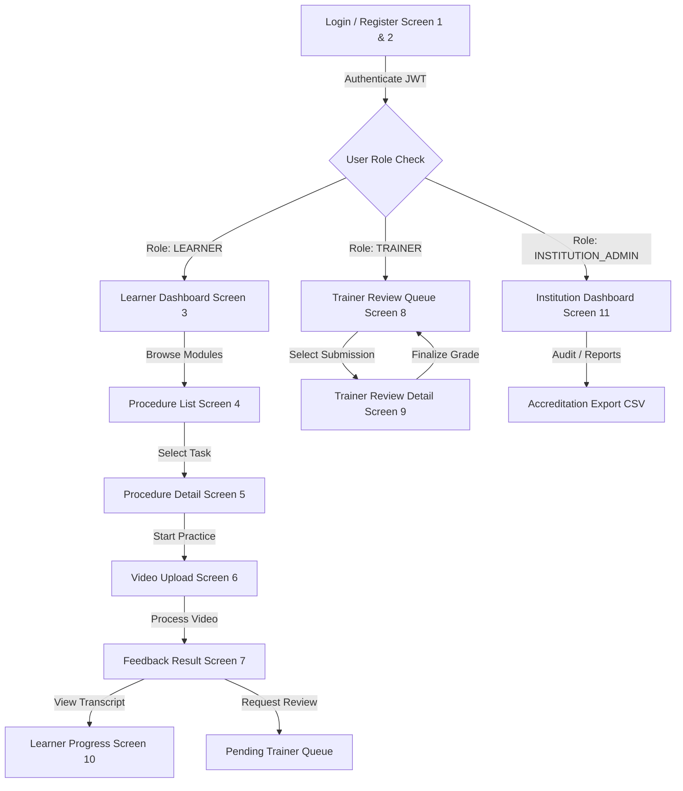

# UI/UX Design System & Frontend Architecture Specification

**Project Name:** Hunar  
**Document Version:** 1.0 (Phase 1 / Phase 2 Architecture Alignment)  
**Status:** Approved for Frontend Implementation  
**Frontend Stack:** Next.js 16 (App Router), React 19, TypeScript, Tailwind CSS 4, Axios  
**Design Tool:** Stitch AI (Prototyping & Layout Generation)  
**Source of Truth:** `README.md` and `docs/phase1/` (`screens.md`, `data-model.md`, `scope.md`, `filming-guidelines.md`)

---

## 1. Architectural Overview & Design Philosophy

The **Hunar** user interface bridges digital AI assessment with hands-on, physical vocational craftsmanship. The interface operates in noisy, high-dust, physical workshop environments where trainees transition directly between handling copper conductors, screwdrivers, and digital devices.

The design philosophy rests on four foundational tenets:
1. **Utility Over Decoration:** Visual elements exist to instruct, clarify, and reinforce electrical safety. Extraneous visual noise and decorative animations that distract from procedural execution are omitted.
2. **Transparent AI Evidence:** The interface never delivers opaque or "black-box" scores. Every AI evaluation is directly grounded in timestamped video evidence, physical visual cues, and explicit error tags.
3. **Safety-First Visual Hierarchy:** Critical safety warnings and violations supersede all other UI elements. Safety hazards are rendered in high-contrast, universally recognizable danger tokens that cannot be ignored.
4. **Empowering the Human Instructor:** The trainer interface is tailored for rapid triage, speed playback, and friction-free overrides, reinforcing the instructor's position as the final authority.

---

## 2. Core Design Principles

### 2.1 Mobile-First & Touch Ergonomics
- **Base Viewport:** All learner-facing interfaces are designed mobile-first targeting a **375px viewport width** (standard budget Android smartphones such as Redmi 9/10, Realme C-series, Samsung Galaxy A-series), fluidly scaling to tablet (768px) and desktop (1024px+).
- **Minimum Touch Targets:** All interactive targets (buttons, filter chips, checkboxes, timeline jump markers) must maintain a minimum physical hit area of **$48\text{px} \times 48\text{px}$** (`min-h-[48px] min-w-[48px]`) with at least $8\text{px}$ separation to accommodate trainees with gloved, taped, or grease-stained fingers.
- **One-Thumb Reachability:** Primary action controls (e.g., "Upload Practice Video", "Run AI Verification", "Jump to Next Step") reside in the bottom 40% of the mobile viewport within natural thumb range.

### 2.2 Accessibility (WCAG 2.1 AA Compliance)
- **Contrast Ratios:** Text and essential icons must satisfy minimum WCAG 2.1 AA contrast thresholds:
  - Normal text ($< 18\text{pt}$ or $< 14\text{pt}$ bold): Minimum contrast ratio of **4.5:1** against backgrounds.
  - Large text ($\ge 18\text{pt}$ or $\ge 14\text{pt}$ bold) and UI components/borders: Minimum contrast ratio of **3.0:1**.
- **Multi-Modal Information Conveyance:** Color is **never** used as the sole conveyor of information. Every status badge or alert combines distinct color, text labels, and semantic iconography (e.g., Emerald Checkmark for Pass, Rose Shield with Exclamation for Safety Violation, Amber Clock for Pending).
- **Keyboard Navigation & Visible Focus:** All interactive elements feature prominent, high-contrast focus rings (`focus-visible:ring-2 focus-visible:ring-indigo-600 focus-visible:ring-offset-2`).
- **Screen Reader Readiness:** Form inputs feature explicit `<label>` tags, video players include `aria-label` attributes on custom scrubber controls, and dynamic alert updates utilize `aria-live="polite"` or `aria-live="assertive"`.

### 2.3 Low-Bandwidth & Workshop-Resilient Performance
- **Zero Heavy Web Fonts:** Leverage modern system sans-serif fonts or preloaded variable fonts (Inter) to eliminate layout shift (CLS) and extra network roundtrips.
- **Vector Icons:** Use lightweight SVG icons (e.g., Lucide React) embedded inline; zero icon web fonts or heavy image sprites.
- **Optimized Media Delivery:** Embedded video players utilize native HTML5 video containers with progressive buffering, responsive thumbnail posters, and chunked video playback.
- **Skeletal & Optimistic States:** Display immediate skeleton placeholders during video upload and asynchronous AI analysis transitions to provide visual feedback over high-latency 3G/4G workshop connections.

---

## 3. Design Tokens & Visual System

### 3.1 Color Palette
The color system utilizes a purposeful Slate neutral base accented by Deep Indigo for platform actions and standardized semantic tokens for electrical safety states:

| Token Name | Hex Code | Tailwind 4 Class | Role & Usage | WCAG AA Contrast |
| :--- | :---: | :--- | :--- | :---: |
| **Neutral Canvas** | `#FFFFFF` | `bg-white` | Card backgrounds, elevated surfaces, modal containers | 21:1 vs Slate 900 |
| **Neutral Substrate** | `#F8FAFC` | `bg-slate-50` | Primary app page background, table header fill | 19.8:1 vs Slate 900 |
| **Neutral Muted** | `#F1F5F9` | `bg-slate-100` | Input fill, inactive tab pills, subtle dividers | 16.5:1 vs Slate 900 |
| **Neutral Border** | `#E2E8F0` | `border-slate-200` | Card borders, table dividers, input borders | 3.2:1 vs Canvas |
| **Text Secondary** | `#475569` | `text-slate-600` | Subtitles, helper text, timestamps, metadata labels | 5.3:1 vs Canvas (Pass) |
| **Text Primary** | `#0F172A` | `text-slate-900` | Page titles, card headings, primary body copy | 18.5:1 vs Canvas (Pass) |
| **Brand Primary** | `#4338CA` | `bg-indigo-700` | Primary CTA buttons, active navigation, active focus rings | 6.8:1 vs Canvas (Pass) |
| **Brand Primary Hover** | `#3730A3` | `bg-indigo-800` | Hover & active states for primary action buttons | 8.9:1 vs Canvas (Pass) |
| **Brand Light Tint** | `#EEF2FF` | `bg-indigo-50` | Active menu card selection, primary icon badges | 1.1:1 (Non-text only) |
| **Safe / Pass** | `#059669` | `bg-emerald-600` | Correct step status, verified competency badge, pass verdict | 4.6:1 vs Canvas (Pass) |
| **Safe Light Tint** | `#ECFDF5` | `bg-emerald-50` | Correct step background pill, passing banner fill | 1.1:1 (Non-text only) |
| **Safe Dark Text** | `#065F46` | `text-emerald-800` | Text label inside green status badges | 7.1:1 vs Emerald 50 |
| **Danger / Safety Fail**| `#DC2626` | `bg-rose-600` | Life-critical safety violation, failed step, urgent alert | 4.8:1 vs Canvas (Pass) |
| **Danger Light Tint** | `#FFF1F2` | `bg-rose-50` | Safety violation alert banner fill, error highlight | 1.1:1 (Non-text only) |
| **Danger Dark Text** | `#9F1239` | `text-rose-800` | Text label inside danger badges, critical alert titles | 7.4:1 vs Rose 50 |
| **Warning / Attention**| `#D97706` | `bg-amber-600` | Inconclusive step, review pending, non-critical defect | 3.6:1 vs Canvas (Large text/UI) |
| **Warning Light Tint** | `#FFFBEB` | `bg-amber-50` | Pending queue card highlight, caution callout fill | 1.1:1 (Non-text only) |
| **Warning Dark Text** | `#92400E` | `text-amber-800` | Text label inside warning badges, caution text | 6.5:1 vs Amber 50 |

### 3.2 Typography System
The typography uses clean geometric sans-serif styling (Inter, system-ui, -apple-system, BlinkMacSystemFont, "Segoe UI", Roboto):

| Typography Role | Size (px) | Rem | Line Height | Tailwind Class | Weight | Tracking | Usage |
| :--- | :---: | :---: | :---: | :--- | :--- | :--- | :--- |
| **Display Heading** | 24px / 30px | 1.5rem / 1.875rem | 1.25 | `text-2xl md:text-3xl` | `font-bold` | `tracking-tight` | Screen titles, login branding |
| **Section Heading** | 20px / 24px | 1.25rem / 1.5rem | 1.3 | `text-xl md:text-2xl` | `font-bold` | `tracking-tight` | Module headers, card section titles |
| **Card / Step Title** | 16px / 18px | 1.0rem / 1.125rem | 1.4 | `text-base md:text-lg` | `font-semibold` | `tracking-normal` | Procedure names, step checklist titles |
| **Body Regular** | 14px / 16px | 0.875rem / 1.0rem | 1.5 | `text-sm md:text-base` | `font-normal` | `tracking-normal` | Explanatory text, feedback notes |
| **Body Medium** | 14px | 0.875rem | 1.5 | `text-sm` | `font-medium` | `tracking-normal` | Form labels, button text, table rows |
| **Caption / Helper**| 12px | 0.75rem | 1.4 | `text-xs` | `font-normal` | `tracking-normal` | Timestamps, file size, secondary tags |
| **Code / Annunciator**| 13px | 0.8125rem | 1.4 | `font-mono text-xs` | `font-semibold` | `tracking-wide` | Multimeter readings (`0.0V`), codes |

### 3.3 Spacing, Grid & Border Radius
- **Base Grid:** Built on an **$8\text{px}$ module** (with a $4\text{px}$ micro-step for fine alignment):
  - Micro: `4px` (`p-1`, `gap-1`), `8px` (`p-2`, `gap-2`)
  - Standard: `16px` (`p-4`, `gap-4`), `24px` (`p-6`, `gap-6`)
  - Macro: `32px` (`p-8`, `gap-8`), `48px` (`py-12`)
- **Border Radii:**
  - Small Pills / Badges: `rounded-full` or `rounded-md` ($6\text{px}$)
  - Buttons & Inputs: `rounded-xl` ($12\text{px}$)
  - Surface Cards & Modals: `rounded-2xl` ($16\text{px}$)
- **Elevation / Shadows:**
  - Flat Card: `shadow-sm border border-slate-200`
  - Floating Action / Dropdown: `shadow-md border border-slate-200`
  - Modal / Critical Dialog: `shadow-xl border border-slate-300`

---

## 4. Core Component Specifications

### 4.1 Buttons
Buttons provide distinct visual hierarchies and clear tactile states:
- **Primary Button:**
  - Classes: `w-full md:w-auto inline-flex items-center justify-center px-6 py-3.5 rounded-xl font-semibold text-white bg-indigo-700 hover:bg-indigo-800 active:bg-indigo-900 focus-visible:ring-2 focus-visible:ring-indigo-600 focus-visible:ring-offset-2 transition-colors min-h-[48px]`
  - Used for: "Sign In", "Run AI Verification", "Submit Practice Video", "Finalize Feedback".
- **Secondary Button:**
  - Classes: `inline-flex items-center justify-center px-5 py-3 rounded-xl font-medium text-slate-700 bg-white border border-slate-300 hover:bg-slate-50 active:bg-slate-100 focus-visible:ring-2 focus-visible:ring-indigo-600 min-h-[48px]`
  - Used for: "Back", "Cancel", "Save Draft", "Export PDF".
- **Danger Button:**
  - Classes: `inline-flex items-center justify-center px-5 py-3 rounded-xl font-semibold text-white bg-rose-600 hover:bg-rose-700 active:bg-rose-800 focus-visible:ring-2 focus-visible:ring-rose-600 min-h-[48px]`
  - Used for: "Review Safety Alert", "Confirm Fail".
- **Success / Quick Approve Button:**
  - Classes: `inline-flex items-center justify-center px-5 py-3 rounded-xl font-semibold text-white bg-emerald-600 hover:bg-emerald-700 active:bg-emerald-800 focus-visible:ring-2 focus-visible:ring-emerald-600 min-h-[48px]`
  - Used for: "Quick Approve", "Confirm Pass".

### 4.2 Form Inputs & Checkboxes
- **Text & Password Inputs:**
  - Classes: `w-full px-4 py-3 rounded-xl border border-slate-300 bg-white text-slate-900 placeholder:text-slate-400 focus:outline-none focus:border-indigo-600 focus:ring-2 focus:ring-indigo-600/20 text-sm md:text-base min-h-[48px]`
  - With Password Reveal: Position an icon button (`p-2 text-slate-400 hover:text-slate-600`) absolutely at `right-3 top-1/2 -translate-y-1/2`.
- **Consent Callout Checkbox Card:**
  - Card container: `p-4 rounded-xl border border-indigo-200 bg-indigo-50/50 flex items-start gap-3.5`
  - Custom Checkbox: `h-5 w-5 mt-0.5 rounded border-slate-300 text-indigo-700 focus:ring-indigo-600`
  - Label: `text-sm text-slate-700 font-medium leading-relaxed`

### 4.3 Safety Banners & Alert Callouts
- **Critical Safety Banner (High Severity):**
  - Container: `p-4 rounded-xl border border-rose-300 bg-rose-50 flex items-start gap-3`
  - Icon: Red Warning Triangle / Shield (`text-rose-600 shrink-0 h-6 w-6`)
  - Content: Title `font-bold text-rose-900 text-sm md:text-base`, Description `text-rose-800 text-xs md:text-sm mt-0.5`
- **Notice / Filming Checklist Banner:**
  - Container: `p-4 rounded-xl border border-slate-200 bg-white flex items-start gap-3`
  - Icon: Info circle (`text-indigo-600 shrink-0 h-5 w-5`)
  - Content: Title `font-semibold text-slate-900 text-sm`, List `text-slate-600 text-xs mt-1 space-y-1`

### 4.4 Status Badges & Pills
- **Pass Badge:**
  - `inline-flex items-center gap-1.5 px-3 py-1 rounded-full text-xs font-semibold bg-emerald-100 text-emerald-800 border border-emerald-300`
  - Icon: `CheckCircle2` (14px)
- **Safety Violation Badge:**
  - `inline-flex items-center gap-1.5 px-3 py-1 rounded-full text-xs font-semibold bg-rose-100 text-rose-800 border border-rose-300`
  - Icon: `AlertOctagon` or `ShieldAlert` (14px)
- **Pending / Inconclusive Badge:**
  - `inline-flex items-center gap-1.5 px-3 py-1 rounded-full text-xs font-semibold bg-amber-100 text-amber-800 border border-amber-300`
  - Icon: `Clock` or `HelpCircle` (14px)
- **Safety Critical Step Pill:**
  - `inline-flex items-center gap-1 px-2.5 py-0.5 rounded-md text-[11px] font-bold uppercase tracking-wider bg-rose-600 text-white shadow-xs`

### 4.5 Video Player Container & Interactive Timeline
The video playback component serves as the central evaluation medium for both learner feedback and instructor review:
- **Aspect Ratio:** Fixed responsive `aspect-video` ($16:9$) inside a `relative overflow-hidden rounded-2xl bg-black border border-slate-800`.
- **Custom Scrubber & Marker Pins:**
  - Scrubber bar: Height $6\text{px}$ with a touch-accessible hit area of $24\text{px}$ (`py-2`).
  - Timeline Pins: Absolutely positioned markers corresponding to step timestamps:
    - Pass marker: $10\text{px}$ green circular pin (`bg-emerald-500 ring-2 ring-white`).
    - Safety defect marker: $12\text{px}$ red diamond or pulsated pin (`bg-rose-600 ring-2 ring-white animate-pulse`).
    - Tapping/clicking a pin seeks the video directly to `timestamp_start` and highlights the corresponding step rubric card.
- **Playback Rate Controls:** Multi-speed buttons (`1x`, `1.25x`, `1.5x`, `2x`) for trainers to accelerate visual verification of continuous physical actions.

### 4.6 Step Evaluation Rubric & Accordion
- **Card Container:** `rounded-xl border transition-all p-4`
  - Correct state: `border-slate-200 bg-white hover:border-emerald-300`
  - Incorrect state: `border-rose-200 bg-rose-50/40`
  - Inconclusive state: `border-amber-200 bg-amber-50/40`
- **Header Section:** Step number badge, step title (`font-semibold text-slate-900`), safety badge (if applicable), timestamp link button (`font-mono text-xs text-indigo-600 hover:underline`), and status pill.
- **Collapsible Body:**
  - AI Feedback: Explanatory paragraph explaining the observed physical action (`text-sm text-slate-700`).
  - Detected Error Tags: Tag chips (e.g., `EXCESS_COPPER_EXPOSED`, `STRAND_DAMAGE`).
  - Video Frame Snapshot: Thumbnail with red bounding box highlighting the defect.

---

## 5. Navigation Architecture & User Journeys



### 5.1 Learner Navigation Flow
- **Mobile Bottom Navigation Bar:**
  - Fixed at screen bottom (`fixed bottom-0 left-0 right-0 z-40 bg-white/95 backdrop-blur-md border-t border-slate-200 py-2 px-6 flex justify-around items-center`).
  - 4 Navigation Tabs:
    1. **Dashboard** (`LayoutDashboard` icon): Overview, active module, recent submissions.
    2. **Procedures** (`BookOpen` icon): Catalog of electrical wiring tasks.
    3. **Progress** (`Award` or `TrendingUp` icon): Competency transcript, safety rating.
    4. **Profile** (`User` icon): Trainee ID, institutional affiliation, consent preferences.
- **Contextual Sticky Header:** Top bar displaying back navigation arrow, current procedure title, and contextual status badge.

### 5.2 Trainer Navigation Flow
- **Desktop/Tablet Responsive Header:**
  - Horizontal top navigation bar with institutional branding, active queue count badge, and trainer avatar.
  - Tabs: "Review Queue", "Trainee Batches", "Procedure Rubrics", "Safety Analytics".
- **Review Detail Split View:** Left 60% dedicated to synchronized video player and playback controls; right 40% dedicated to scrollable step rubrics and grade overrides.

### 5.3 Institution Admin Navigation Flow
- **Analytics & Oversight Bar:** High-level metrics view with batch selector, term filter, and export CTA ("Export Accreditation Audit Report").

---

## 6. Screen Inventory & Stitch AI Workflow

The frontend comprises **11 distinct screens** designed using Stitch AI. Each screen specification includes its purpose, target viewport, key elements, interaction states, and the exact prompt used for generative layout prototyping:

```
┌────────────────────────────────────────────────────────────────────────────┐
│                             SCREEN INVENTORY                                │
├────────────┬─────────────────────────────┬─────────────────┬───────────────┤
│ Screen ID  │ Screen Name                 │ Primary Persona │ Target View   │
├────────────┼─────────────────────────────┼─────────────────┼───────────────┤
│ Screen 1   │ Login                       │ All Roles       │ Mobile (375px)│
│ Screen 2   │ Register & Consent          │ Learner         │ Mobile (375px)│
│ Screen 3   │ Learner Dashboard           │ Learner         │ Mobile (375px)│
│ Screen 4   │ Procedure List (Catalog)    │ Learner         │ Mobile (375px)│
│ Screen 5   │ Procedure Detail & Safety   │ Learner         │ Mobile (375px)│
│ Screen 6   │ Video Upload & Verification │ Learner         │ Mobile (375px)│
│ Screen 7   │ Feedback Result & Evidence  │ Learner         │ Mobile (375px)│
│ Screen 8   │ Trainer Review Queue        │ Trainer         │ Desktop/Tablet│
│ Screen 9   │ Trainer Review Detail       │ Trainer         │ Desktop/Tablet│
│ Screen 10  │ Learner Progress Transcript │ Learner         │ Mobile (375px)│
│ Screen 11  │ Institution Admin Dashboard │ Admin           │ Desktop       │
└────────────┴─────────────────────────────┴─────────────────┴───────────────┘
```

---

### Screen 1: Login
- **Target Persona:** All Roles (Learner, Trainer, Institution Admin).
- **Primary Viewport:** Mobile (375px) responsive to desktop card.
- **Purpose:** Secure JWT authentication and role redirection.
- **Key Elements:** Electrical lightning icon badge, application title, email/username input, password input with show/hide eye toggle, "Sign In" button, "Forgot Password" link, link to Register.
- **Stitch AI Prompt:**
```text
Create a clean, mobile-first Login screen for the "Hunar" web app using Tailwind CSS. Use a minimalist slate-50 background. Centered card on a subtle white background with rounded-2xl corners, soft drop shadow, and a 1px slate-200 border. At the top, include an electrical bolt icon inside an indigo-100 rounded badge, followed by the title "Vocational Trainer" in font-bold text-slate-900 and subtitle "Sign in to your training portal" in text-slate-500. Include form fields for Email Address and Password with clean slate-100 borders and focus:ring-2 focus:ring-indigo-600. Add a password visibility toggle icon. Include a prominent full-width "Sign In" button (bg-indigo-700 text-white font-medium py-3 rounded-xl hover:bg-indigo-800 transition). Below, include links for "Forgot password?" and "Don't have an account? Register with your Institution ID".
```

---

### Screen 2: Register & Consent
- **Target Persona:** Learner (Vocational Trainee).
- **Primary Viewport:** Mobile (375px).
- **Purpose:** Trainee enrollment, institutional linking, and legally compliant consent acknowledgement.
- **Key Elements:** Back button, Full Name, Trainee Roll Number, Institutional Email, Password, Institution Selector dropdown, pre-selected Trade badge ("Electrician"), highlighted Consent card with agreement checkbox and modal policy link, "Register & Start Training" button.
- **Stitch AI Prompt:**
```text
Create a mobile-friendly Registration screen for the "Hunar" using Tailwind CSS. Clean, spacious layout on a slate-50 background. Include a top back-arrow button to return to Login. Title: "Create Trainee Account" with subtitle "Join your institution's electrical workshop portal". Form fields: Full Name, Trainee Roll Number, Institutional Email, and Password with validation indicators. Include an Institution dropdown selector and a pre-selected badge for Trade: "Electrician (Basic Wiring)". Include a highlighted card with an info icon containing a checkbox: "I agree to the Video Recording & Practice Evaluation Consent Policy" with a modal link to read the full policy. A primary full-width button "Register & Start Training" in bg-indigo-700 with rounded-xl padding.
```

---

### Screen 3: Learner Dashboard
- **Target Persona:** Learner.
- **Primary Viewport:** Mobile (375px).
- **Purpose:** Trainee home hub showing active module progress, safety score, and recent submission status.
- **Key Elements:** Top app bar with avatar, greeting "Hello, Devraj (Batch ELEC-2026 • Govt ITI)", stat cards (Procedures Completed: 3/4, Safety Score: 100%, Pending Review: 1), active module hero card with 75% progress bar and "Continue Procedure" button, recent submissions list with status pills (`Pass`, `Trainer Review Pending`, `Safety Violation Detected`), bottom navigation bar.
- **Stitch AI Prompt:**
```text
Create a modern mobile-first Learner Dashboard for the "Hunar" in Tailwind CSS. Top app bar with learner avatar, notification bell, and greeting "Hello, Devraj" with subtitle "Batch ELEC-2026 • Govt ITI". Top stat row with 3 cards: "Procedures Completed: 3/4", "Safety Score: 100%", and "Pending Review: 1". Featured hero card with an indigo-gradient background: "Active Module: Switch & Socket Installation", showing an 75% progress bar and a white CTA button "Continue Procedure". Below, section titled "Recent Practice Submissions" displaying a list of 3 items: each item shows procedure title, date, thumbnail preview, and a pill badge: one green "Pass (AI Verified)", one amber "Trainer Review Pending", and one red "Safety Violation Detected". Bottom navigation bar with 4 tabs: Dashboard, Procedures, Progress, Profile.
```

---

### Screen 4: Procedure List (Catalog)
- **Target Persona:** Learner.
- **Primary Viewport:** Mobile (375px).
- **Purpose:** Browse and select electrical wiring procedures.
- **Key Elements:** Search input, horizontal filter chips ("All", "Lighting Circuits", "Sockets & Power", "Testing & Safety"), procedure cards (`PROC-ELEC-01` to `04`) displaying difficulty badge, duration, completion checkmark, safety shield indicator, chevron navigation.
- **Stitch AI Prompt:**
```text
Design a mobile Procedure Catalog screen for an electrical vocational training app using Tailwind CSS. Sticky top header with search input and horizontal filter chips: "All", "Lighting Circuits", "Sockets & Power", "Testing & Safety". The list displays cards for 4 procedures:
1. PROC-ELEC-01: Single-Pole Switch & Lamp (Beginner • 20 mins • Completed checkmark)
2. PROC-ELEC-02: Switch-Controlled Socket Outlet (Intermediate • 25 mins • Start Practice button)
3. PROC-ELEC-03: Two-Way Staircase Circuit (Intermediate • 30 mins)
4. PROC-ELEC-04: Dead-Circuit Safety Testing (Beginner • 20 mins • Safety Shield icon)
Each card features clear typography, a subtle slate-200 border, difficulty badge, clock icon with time estimate, and a Chevron-right indicator. Clean, high-contrast, touch-accessible cards.
```

---

### Screen 5: Procedure Detail & Safety Briefing
- **Target Persona:** Learner.
- **Primary Viewport:** Mobile (375px).
- **Purpose:** Pre-practice briefing, equipment checklist, and safety warning enforcement.
- **Key Elements:** Top back button, prominent Red-50 safety alert banner ("CRITICAL: Power supply must remain disconnected and proven dead with multimeter before starting work"), Required Tools & Materials pill chips (1000V Pliers, Wire Stripper, Multimeter, 16A Socket, Switch), numbered step checklist with prominent "Safety Critical" badges on steps 1, 3, 4, 6, and 9, fixed bottom CTA button "I Have My Tools Ready - Upload Practice Video".
- **Stitch AI Prompt:**
```text
Create an accessible mobile Procedure Detail screen for "PROC-ELEC-02: Switch-Controlled Socket Outlet" in Tailwind CSS. Top navigation with back button and share icon. Prominent red-50 safety alert banner at top with a warning triangle: "CRITICAL: Power supply must remain disconnected and proven dead with multimeter before starting work." Section for "Required Tools & Materials" displaying clean icon pills: 1000V Pliers, Wire Stripper, Multimeter, 16A Socket, Modular Switch. Section for "Step-by-Step Procedure Checklist" with 9 numbered items. Steps 1, 3, 4, 6, and 9 display a prominent red pill badge "Safety Critical". Each step item shows step ID, title, and expand arrow. Fixed bottom bar with a full-width high-contrast button: "I Have My Tools Ready - Upload Practice Video" (bg-indigo-700 text-white py-3.5 rounded-xl font-semibold).
```

---

### Screen 6: Video Upload & Verification
- **Target Persona:** Learner.
- **Primary Viewport:** Mobile (375px).
- **Purpose:** Video file selection, filming checklist verification, and upload progress.
- **Key Elements:** Collapsible 4-point filming checklist (Landscape, Mounted on stand, Bright light, Uncut 5-8 min take), dashed drag-and-drop / file selector zone ("Tap to record or select MP4/WebM video"), selected video card preview (filename, file size, duration, green checkmark), upload progress bar (100%), "Run AI Step Verification" CTA button.
- **Stitch AI Prompt:**
```text
Create a mobile-first Video Upload screen for the "Hunar" using Tailwind CSS. Header: "Submit Practice Recording" for PROC-ELEC-02. Top collapsible accordion titled "Quick Filming Checklist" with 4 checked items: "Landscape mode", "Phone mounted on stand", "Terminals brightly lit", "Uncut 5-8 min video". Central interactive upload zone with a dashed indigo-300 border, cloud upload icon, text "Tap to record or select MP4/WebM video", and helper text "Max size: 250MB • 1080p recommended". Below the upload zone, show an uploaded video card preview with filename "socket_practice_devraj.mp4", size "84.2 MB", duration "6m 12s", and a green checkmark. An active upload progress bar at 100% with text "Upload complete. Ready for analysis". A prominent primary button "Run AI Step Verification" in bg-indigo-700 text-white py-3.5 rounded-xl.
```

---

### Screen 7: Feedback Result & Evidence
- **Target Persona:** Learner.
- **Primary Viewport:** Mobile (375px).
- **Purpose:** Detailed step-by-step evaluation report with timestamped video evidence and error tags.
- **Key Elements:** Top verdict banner (Red-100: "Verdict: Safety Violation Detected - Re-practice Required"), embedded video player with colored timeline pins (green dots for correct steps, red dot at 02:45 for defect), step rubric cards with timestamp seek buttons, expanded card for Step 3 showing error tag `EXCESS_COPPER_EXPOSED`, risk explanation, snapshot thumbnail, floating action button "Submit to Instructor for Verification".
- **Stitch AI Prompt:**
```text
Design a comprehensive mobile-friendly Feedback Result screen for a completed electrical wiring attempt in Tailwind CSS. Top banner: Red-100 background with dark red border and icon displaying "Verdict: Safety Violation Detected - Re-practice Required". Below banner, an interactive video player container with playback controls and a custom timeline scrubber displaying colored marker pins corresponding to steps (green dots for correct steps, red dot at 02:45 for mistake). Below video, "Step Analysis Rubric":
- Step 1: Supply Isolation (Green checkmark • Correct • 00:15)
- Step 3: Earth Conductor Termination (Red warning icon • Incorrect • 02:45) -> Expanded card showing: "Error Tag: Excess Copper Exposed (> 5mm bare wire outside terminal shroud). Risk: Shock hazard." Includes a snapshot thumbnail of the error.
- Step 4: Neutral Conductor Termination (Green checkmark • Correct • 03:10)
Bottom floating action button: "Submit to Instructor for Verification".
```

---

### Screen 8: Trainer Review Queue
- **Target Persona:** Trainer (Vocational Instructor).
- **Primary Viewport:** Desktop / Tablet (1024px+).
- **Purpose:** Triage and prioritization of pending practical submissions.
- **Key Elements:** Queue header ("Practical Assessment Queue • 8 Pending Submissions"), filter tabs ("All (8)", "Safety Alerts (3)", "AI Passed (5)"), search bar (name, roll number), submission cards: Card 1 (Red border, student Devraj Sharma, `PROC-ELEC-02`, "Safety Alert: Excess Copper Exposed", "Review Now" button), Card 2 (student Pooja Patel, `PROC-ELEC-01`, "Passed (9/9 Steps)", "Quick Approve" button).
- **Stitch AI Prompt:**
```text
Create a clean, efficient Trainer Review Queue screen for desktop and tablet in Tailwind CSS. Top header: "Practical Assessment Queue" with badge "8 Pending Submissions". Filter tabs: "All (8)", "Safety Alerts (3)", "AI Passed (5)". Search bar: "Search by student name or roll number...". The queue displays a table/card list:
- Card 1 (High Priority Red Border): Student "Devraj Sharma (TRN-045)", Procedure "PROC-ELEC-02 (Socket Wiring)", Submitted "15 mins ago", AI Verdict: "Safety Alert: Excess Copper Exposed", Button: "Review Now (2 min triage)" in bg-rose-600 text-white.
- Card 2: Student "Pooja Patel (TRN-022)", Procedure "PROC-ELEC-01 (Switch & Lamp)", Submitted "1 hour ago", AI Verdict: "Passed (9/9 Steps)", Button: "Quick Approve" in bg-emerald-600 text-white.
Clean tabular layout with avatar, timestamp, status tags, and action buttons.
```

---

### Screen 9: Trainer Review Detail
- **Target Persona:** Trainer.
- **Primary Viewport:** Desktop / Tablet (Split Screen: 60/40).
- **Purpose:** Synchronized video inspection, AI score override, and official grading sign-off.
- **Key Elements:** Left pane (60%): Video player with speed controls (1x, 1.25x, 1.5x) and jump buttons ("Jump to Step 3 Error [02:45]"). Right pane (40%): Trainee info header, scrollable step checklist with side-by-side radio buttons (`[Confirm Fail] [Override to Pass]`), trainer coaching note input, final grade selector (`[Competent] [Not Yet Competent] [Safety Fail]`), "Save Draft" and "Finalize & Send Feedback" buttons.
- **Stitch AI Prompt:**
```text
Design a desktop/tablet split-screen Trainer Review Detail interface in Tailwind CSS. Left side (60% width): Large video player with playback speed controls (1x, 1.25x, 1.5x) and timestamp jump buttons ("Jump to Step 3 Error [02:45]"). Right side (40% width): Interactive grading panel. Student info header: "Devraj Sharma • PROC-ELEC-02". Scrollable step list:
Step 3: Protective Earth Termination. AI Verdict: "Incorrect". Side-by-side trainer radio buttons: [Confirm Fail] [Override to Pass]. Text input for trainer note: "Trim 4mm off the copper before inserting into earth terminal."
Bottom panel: Final Verdict selector with 3 pill buttons: [Competent] [Not Yet Competent] [Safety Fail (Selected)]. Large text area for "Instructor Coaching Summary". Bottom sticky action bar with "Save Draft" and "Finalize & Send Feedback to Student" (bg-indigo-700 text-white font-semibold py-3 px-6 rounded-xl).
```

---

### Screen 10: Learner Progress Transcript
- **Target Persona:** Learner.
- **Primary Viewport:** Mobile (375px).
- **Purpose:** Longitudinal competency tracking, safety compliance record, and skill portfolio export.
- **Key Elements:** Student profile card, circular progress dial ("75% Practical Competency"), Gold shield badge ("100% Zero-Defect Post-Correction Record"), Module competencies with 4 progress bars (`PROC-ELEC-01` to `04`), verified tasks list with instructor sign-offs, "Export Practical Skills Portfolio (PDF)" outline button.
- **Stitch AI Prompt:**
```text
Create a motivating mobile-friendly Learner Progress & Competency screen in Tailwind CSS. Top card: Student profile with photo, name "Devraj Sharma", trade "Electrician Level 1", and a circular progress ring showing "75% Practical Competency". Section for "Safety Record": Gold shield badge with "100% Zero-Defect Post-Correction Record". Middle section: "Module Competencies" with 4 progress bars:
1. Single Pole Lighting: 100% Mastered (Green bar)
2. Socket Installation: 70% In Progress (Amber bar)
3. Two-Way Staircase: 50% In Progress
4. Dead-Circuit Testing: 100% Mastered
Bottom list: "Recent Certified Tasks" showing verified timestamps, instructor signatures, and a secondary outline button "Export Practical Skills Portfolio (PDF)".
```

---

### Screen 11: Institution Admin Dashboard
- **Target Persona:** Institution Administrator (Principal / Training Head).
- **Primary Viewport:** Desktop (1280px+).
- **Purpose:** Executive governance, cohort safety tracking, failure frequency analytics, and accreditation exports.
- **Key Elements:** Top bar with institution title, term selector dropdown ("Academic Year 2026 - Term 1"), "Export Accreditation Audit Report" CTA, 4 KPI cards (Enrolled Trainees: 142, Exercises Logged: 586, First-Time Safety Compliance: 88.4%, Avg Review Time: 1.8 mins), two charts (Failure Frequency by Error Tag; Batch Velocity), Instructor activity table.
- **Stitch AI Prompt:**
```text
Create a professional, data-dense Institution Admin Dashboard for vocational training centers in Tailwind CSS. Top navigation bar with institution logo "Govt Industrial Training Institute", term selector dropdown "Academic Year 2026 - Term 1", and "Export Accreditation Audit Report" button.
Top row of 4 KPI metric cards:
1. "Enrolled Trainees": 142 (Active in 6 Batches)
2. "Practical Exercises Logged": 586 submissions
3. "First-Time Safety Compliance": 88.4% (+4.2% vs last month)
4. "Avg Instructor Review Time": 1.8 mins / video
Middle section: Two charts side-by-side:
- Left: "Step Failure Frequency by Trade Module" (bar chart showing top failure modes: Over-stripping copper, Loose screw torque, Reversed polarity).
- Right: "Batch Practical Velocity & Completion".
Bottom section: "Instructor Triage Activity" table showing Trainer Name, Batches Assigned, Submissions Reviewed, and Average Feedback Turnaround Time. Clean, high-contrast, modern institutional design.
```

---

## 7. Rules for Converting Stitch Output into React Components

Stitch AI outputs rapid visual prototypes (often as flat JSX or static Tailwind markup). To transition these layouts into robust, maintainable, production Next.js 16 components, developers must strictly adhere to the following 7 conversion rules:

### Rule 1: Deconstruct Monoliths into Reusable Atomic Components
Never commit raw, 500-line monolithic JSX files generated by Stitch. Break every layout down into atomic parts:
- `frontend/components/ui/`: Dumb presentational atoms (Button, Badge, Card, Input, Checkbox, Modal, AlertBanner).
- `frontend/components/video/`: Specialized media components (VideoPlayer, TimelineScrubber, StepMarkerPin, SpeedControl).
- `frontend/components/rubrics/`: Domain-specific components (StepChecklist, StepScoreCard, ErrorTagBadge, OverrideSelector).
- `frontend/app/(roles)/`: Next.js page route views consuming the above components.

### Rule 2: Enforce Strict TypeScript Interfaces Aligned with Backend Models
Every component prop must be strongly typed, matching the Django REST Framework serializers and database schemas defined in `docs/phase1/data-model.md`:

```typescript
// types/submission.ts
export type StepStatus = 'CORRECT' | 'INCORRECT' | 'INCONCLUSIVE';
export type OverallVerdict = 'PENDING' | 'PASS' | 'NEEDS_PRACTICE' | 'SAFETY_VIOLATION';
export type TrainerGrade = 'COMPETENT' | 'NOT_YET_COMPETENT' | 'SAFETY_FAIL';

export interface StepScore {
  id: string;
  procedure_step_id: string;
  step_code: string;
  title: string;
  ai_status: StepStatus;
  confidence_score: number;
  timestamp_start: number | null;
  timestamp_end: number | null;
  ai_feedback: string;
  detected_error_tags: string[];
  is_safety_critical: boolean;
  trainer_override: boolean;
}

export interface PracticeSubmission {
  id: string;
  procedure_code: string;
  procedure_title: string;
  learner_name: string;
  video_file_url: string;
  video_duration_seconds: number;
  processing_status: 'UPLOADED' | 'QUEUED' | 'PROCESSING' | 'ANALYZED' | 'REVIEWED' | 'FAILED';
  overall_ai_verdict: OverallVerdict;
  step_scores: StepScore[];
  submitted_at: string;
}
```

### Rule 3: Normalize Tailwind CSS 4 Classes
- **Purge Arbitrary Hardcoded Values:** Replace arbitrary Tailwind values (e.g., `w-[342px]` or `bg-[#059669]`) with design token classes (`w-full max-w-sm` or `bg-emerald-600`).
- **Standardize Touch Targets:** Ensure all clickable elements explicitly include `min-h-[48px] min-w-[48px]` or adequate surrounding padding.
- **Preserve Dark Mode Readiness:** Use semantic slate palette classes (`bg-white dark:bg-slate-900 text-slate-900 dark:text-slate-100`) rather than pure black/white hardcoding.

### Rule 4: Decouple Layout from State & Integrate Axios
Stitch produces static mocked data. Replace mocks with standard React state management and typed Axios client instances:
- Use custom hooks (e.g., `useSubmission(id)`, `useReviewQueue()`) to isolate data fetching.
- Configure Axios interceptors in `frontend/lib/api.ts` to automatically attach JWT Bearer tokens from local storage and handle 401 token refresh cycles.
- Provide explicit loading skeleton states (`<StepCardSkeleton />`) and error recovery boundaries (`<UploadErrorBoundary />`).

### Rule 5: Hardcode Accessibility & Semantic HTML
Stitch prototypes frequently use generic `<div>` tags with `onClick` handlers. When converting to React:
- Convert clickable divs into native `<button type="button">` elements.
- Add `aria-label` to icon-only buttons (e.g., `<button aria-label="Toggle password visibility">`).
- Ensure all form inputs have associated `<label htmlFor="id">` elements.
- Wrap safety alerts in `<div role="alert" aria-live="assertive">` so assistive screen readers announce safety violations immediately.

### Rule 6: Implement Synchronized Video Ref Hooks
For Screen 7 (Learner Feedback) and Screen 9 (Trainer Review), the video player must synchronize bi-directionally with the step rubric:
- Maintain a single `videoRef = useRef<HTMLVideoElement>(null)` at the container level.
- Expose a `seekTo(timestamp: number)` callback to step cards and timeline marker pins.
- Bind the video `onTimeUpdate` event to an active step state to automatically highlight the corresponding step card as video playback progresses.

### Rule 7: Enforce Responsive Breakpoint Grace
Stitch often generates a layout tuned strictly for mobile or desktop. Developers must ensure seamless breakpoint transitions:
- Mobile ($< 768\text{px}$): Single-column stacked layouts, bottom fixed navigation bar, full-width modal sheets.
- Tablet ($768\text{px} - 1024\text{px}$): 2-column grids for catalog cards, collapsible side navigation.
- Desktop ($\ge 1024\text{px}$): Split-screen review workbench (60% video / 40% rubrics), persistent top bar, multi-column analytics tables.

---

## 8. Open Questions & Items Marked "TO CONFIRM"

1. **Video Streaming Architecture [TO CONFIRM]:**
   - Whether the MVP serves uploaded MP4 files directly via progressive HTTP range requests (`Accept-Ranges: bytes`) from Django media storage, or requires an adaptive bitrate HLS/DASH transcoder (e.g., via ffmpeg worker) for mobile playback over constrained 3G connections.
2. **Offline Filming Checklist Persistence [TO CONFIRM]:**
   - Whether the 5-point filming checklist state should be stored in browser `localStorage` across practice sessions so returning trainees can bypass the modal.
3. **Multi-Speed Audio Pitch Correction [TO CONFIRM]:**
   - Whether native HTML5 `<video playbackRate={1.5}>` preserves intelligible audio pitch on budget Android webview browsers during instructor speed review.
4. **Printable Competency PDF Template Standards [TO CONFIRM]:**
   - Regional vocational training board requirements for official certificate layouts, institutional watermarks, and verification QR-code metadata.
