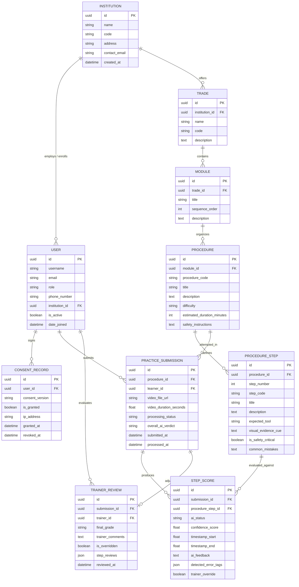

# Proposed Django Data Model (Phase 2 Architecture)

**Project:** Hunar  
**Document Status:** Architecture Design Specification (Design Only)  
**Notice:** **Design only: do NOT create any Django models or migrations during Phase 1.**

---

## 1. Architectural Overview

The backend data architecture is built on standard PostgreSQL relational structures managed through Django ORM. The architecture guarantees:
1. Strict Role-Based Access Control (RBAC) across Learners, Trainers, and Institution Administrators.
2. Complete audit trails of practice submissions, AI inferences, and human trainer overrides.
3. Fine-grained step-level evaluations with timestamped evidence.
4. Independent verification and tracking of safety-critical steps.

---

## 2. Mermaid Entity-Relationship (ER) Diagram

---

## 3. Detailed Model Specifications

### 3.1 `Institution`
Represents a partner vocational training center, ITI, or polytechnic.
- `id`: `UUIDField(primary_key=True, default=uuid.uuid4, editable=False)`
- `name`: `CharField(max_length=255, unique=True)` — Full institution name (e.g., "Government ITI Mumbai").
- `code`: `CharField(max_length=50, unique=True)` — Short institutional code (e.g., "GITI-MUM").
- `address`: `TextField(blank=True)`
- `contact_email`: `EmailField()`
- `created_at`: `DateTimeField(auto_now_add=True)`

### 3.2 `User` (Extends `AbstractUser`)
Custom user model storing accounts with distinct roles and institutional links.
- `id`: `UUIDField(primary_key=True, default=uuid.uuid4, editable=False)`
- `email`: `EmailField(unique=True)`
- `role`: `CharField(max_length=20, choices=[('LEARNER', 'Learner'), ('TRAINER', 'Trainer'), ('INSTITUTION_ADMIN', 'Institution Admin'), ('SUPER_ADMIN', 'Super Admin')], default='LEARNER')`
- `institution`: `ForeignKey(Institution, on_delete=models.SET_NULL, null=True, blank=True, related_name='users')`
- `phone_number`: `CharField(max_length=20, blank=True)`
- `trainee_id_number`: `CharField(max_length=100, blank=True)` — Institutional enrollment number.

### 3.3 `ConsentRecord`
Maintains immutable proof of trainee privacy and recording consent.
- `id`: `UUIDField(primary_key=True, default=uuid.uuid4, editable=False)`
- `user`: `ForeignKey(User, on_delete=models.CASCADE, related_name='consents')`
- `consent_version`: `CharField(max_length=20)` — e.g., "v1.0-2026"
- `is_granted`: `BooleanField(default=False)`
- `ip_address`: `GenericIPAddressField(null=True, blank=True)`
- `user_agent`: `TextField(blank=True)`
- `granted_at`: `DateTimeField(auto_now_add=True)`
- `revoked_at`: `DateTimeField(null=True, blank=True)`

### 3.4 `Trade`
High-level vocational trade categorization.
- `id`: `UUIDField(primary_key=True, default=uuid.uuid4, editable=False)`
- `institution`: `ForeignKey(Institution, on_delete=models.CASCADE, related_name='trades')`
- `name`: `CharField(max_length=150)` — e.g., "Electrician"
- `code`: `CharField(max_length=20)` — e.g., "ELEC"
- `description`: `TextField(blank=True)`

### 3.5 `Module`
Curricular module or unit within a trade.
- `id`: `UUIDField(primary_key=True, default=uuid.uuid4, editable=False)`
- `trade`: `ForeignKey(Trade, on_delete=models.CASCADE, related_name='modules')`
- `title`: `CharField(max_length=200)` — e.g., "Domestic Wiring & Installation"
- `sequence_order`: `PositiveIntegerField(default=1)`
- `description`: `TextField(blank=True)`

### 3.6 `Procedure`
A specific hands-on physical wiring task.
- `id`: `UUIDField(primary_key=True, default=uuid.uuid4, editable=False)`
- `module`: `ForeignKey(Module, on_delete=models.CASCADE, related_name='procedures')`
- `procedure_code`: `CharField(max_length=50, unique=True)` — e.g., "PROC-ELEC-01"
- `title`: `CharField(max_length=255)` — e.g., "Single-Pole Switch Controlling a Batten Lamp"
- `description`: `TextField()`
- `difficulty`: `CharField(max_length=20, choices=[('BEGINNER', 'Beginner'), ('INTERMEDIATE', 'Intermediate'), ('ADVANCED', 'Advanced')])`
- `estimated_duration_minutes`: `PositiveIntegerField(default=20)`
- `safety_instructions`: `TextField()`

### 3.7 `ProcedureStep`
Individual graded procedural step within a procedure.
- `id`: `UUIDField(primary_key=True, default=uuid.uuid4, editable=False)`
- `procedure`: `ForeignKey(Procedure, on_delete=models.CASCADE, related_name='steps')`
- `step_number`: `PositiveIntegerField()`
- `step_code`: `CharField(max_length=50)` — e.g., "SWS-01", "SKT-03"
- `title`: `CharField(max_length=200)` — e.g., "Verify Supply Isolation"
- `description`: `TextField()`
- `expected_tool`: `CharField(max_length=150, blank=True)` — e.g., "Digital Multimeter"
- `visual_evidence_cue`: `TextField()` — What visual indicators the model looks for.
- `is_safety_critical`: `BooleanField(default=False)` — Life-critical gate flag.
- `common_mistakes`: `TextField(blank=True)`

### 3.8 `PracticeSubmission`
A trainee's video upload attempt.
- `id`: `UUIDField(primary_key=True, default=uuid.uuid4, editable=False)`
- `procedure`: `ForeignKey(Procedure, on_delete=models.CASCADE, related_name='submissions')`
- `learner`: `ForeignKey(User, on_delete=models.CASCADE, related_name='submissions')`
- `video_file`: `FileField(upload_to='submissions/videos/%Y/%m/%d/')`
- `video_duration_seconds`: `FloatField(null=True, blank=True)`
- `processing_status`: `CharField(max_length=30, choices=[('UPLOADED', 'Uploaded'), ('QUEUED', 'Queued for Analysis'), ('PROCESSING', 'Processing'), ('ANALYZED', 'Analyzed'), ('REVIEWED', 'Reviewed by Trainer'), ('FAILED', 'Processing Failed')], default='UPLOADED')`
- `overall_ai_verdict`: `CharField(max_length=30, choices=[('PENDING', 'Pending'), ('PASS', 'Pass'), ('NEEDS_PRACTICE', 'Needs Practice'), ('SAFETY_VIOLATION', 'Safety Violation')], default='PENDING')`
- `submitted_at`: `DateTimeField(auto_now_add=True)`
- `processed_at`: `DateTimeField(null=True, blank=True)`

### 3.9 `StepScore`
Step-level AI evaluation results.
- `id`: `UUIDField(primary_key=True, default=uuid.uuid4, editable=False)`
- `submission`: `ForeignKey(PracticeSubmission, on_delete=models.CASCADE, related_name='step_scores')`
- `procedure_step`: `ForeignKey(ProcedureStep, on_delete=models.CASCADE, related_name='scores')`
- `ai_status`: `CharField(max_length=20, choices=[('CORRECT', 'Correct'), ('INCORRECT', 'Incorrect'), ('INCONCLUSIVE', 'Inconclusive')])`
- `confidence_score`: `FloatField(help_text="Model confidence between 0.0 and 1.0")`
- `timestamp_start`: `FloatField(null=True, blank=True)`
- `timestamp_end`: `FloatField(null=True, blank=True)`
- `ai_feedback`: `TextField()` — Detailed explanation generated for the learner.
- `detected_error_tags`: `JSONField(default=list)` — List of error tag codes.
- `trainer_override`: `BooleanField(default=False)`

### 3.10 `TrainerReview`
Official human instructor moderation and final grading.
- `id`: `UUIDField(primary_key=True, default=uuid.uuid4, editable=False)`
- `submission`: `OneToOneField(PracticeSubmission, on_delete=models.CASCADE, related_name='trainer_review')`
- `trainer`: `ForeignKey(User, on_delete=models.CASCADE, related_name='reviews_given')`
- `final_grade`: `CharField(max_length=20, choices=[('COMPETENT', 'Competent / Pass'), ('NOT_YET_COMPETENT', 'Not Yet Competent'), ('SAFETY_FAIL', 'Safety Fail')])`
- `trainer_comments`: `TextField(blank=True)`
- `is_overridden`: `BooleanField(default=False)` — Indicates whether trainer changed any AI verdict.
- `step_reviews`: `JSONField(default=dict)` — Overrides and notes per step ID.
- `reviewed_at`: `DateTimeField(auto_now_add=True)`
